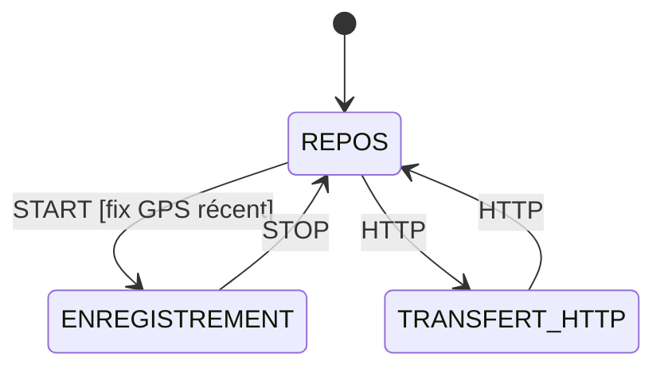

# Car_Traces — Enregistreur de trajets GPS avec Arduino UNO Q

> **Documentation française — version de travail (23 novembre 2026).** Le programme a fait l'objet d'essais fonctionnels, dont un test concluant de rotation à 20 fichiers GPX. La validation sur plusieurs trajets réels et le test de coupure brutale d'alimentation restent à compléter avant publication définitive.

## 1. Présentation

**Car_Traces** enregistre les trajets d'un véhicule au format **GPX 1.1** à l'aide d'une **Arduino UNO Q**, d'un récepteur GPS et d'un **Modulino Buttons**. Les traces sont stockées sur l'UNO Q et récupérables par un serveur HTTP activé à la demande.

Ce projet illustre la collaboration entre les deux environnements de l'UNO Q :

- le **MCU**, programmé en C++, lit le GPS et les boutons et pilote les LED ;
- le **MPU**, sous Linux et programmé en Python avec Arduino App Lab, détient l'état de référence, applique la logique métier, écrit les GPX et gère le serveur HTTP.

Le principe architectural est volontairement simple : **le MCU détecte les événements et transmet les données ; le MPU prend les décisions applicatives ; le MCU reflète ensuite l'état décidé par le MPU.**

## 2. Matériel et environnement

- Arduino **UNO Q** ;
- récepteur GPS fournissant des trames NMEA sur liaison série UART ;
- **Modulino Buttons** (trois boutons et trois LED) ;
- alimentation adaptée à l'UNO Q, notamment pour l'usage embarqué ;
- Arduino App Lab et les bibliothèques utilisées dans le sketch : `TinyGPSPlus`, `Arduino_RouterBridge`, `Arduino_Modulino`.

Le sketch utilise `Serial1.begin(9600)` pour le GPS et le bus utilisé par `Modulino.begin()` pour les boutons. **Avant publication, ajouter une photographie et un schéma de câblage vérifié** (alimentation, masse, TX/RX et connexion du Modulino). Ne pas déduire le brochage du seul nom `Serial1`.

## 3. Architecture MCU / MPU

```text
 Récepteur GPS (NMEA)                 Modulino Buttons
          |                                  |
          v                                  v
 +---------------------------------------------------+
 | MCU — sketch.ino                                  |
 | - Décode les trames GPS avec TinyGPSPlus          |
 | - Détecte les fronts d'appui sur A, B et C        |
 | - Envoie les données et commandes au MPU          |
 | - Affiche sur les LED l'état reçu du MPU          |
 +-----------------------+---------------------------+
                         | Arduino Bridge
                         v
 +---------------------------------------------------+
 | MPU — python/main.py                              |
 | - État applicatif et décisions START/STOP/HTTP    |
 | - Vérification du fix récent                      |
 | - Création, écriture et rotation des fichiers GPX |
 | - Réparation au démarrage des GPX non fermés      |
 | - Serveur HTTP de consultation et téléchargement  |
 +---------------------------------------------------+
```

### Échanges par Bridge

| Fonction Python exposée | Appelée par le MCU | Rôle |
|---|---|---|
| `update_gps(...)` | À la réception d'une position mise à jour et valide selon les contrôles du sketch | Met à jour les données GPS et écrit éventuellement un point |
| `bouton("START"/"STOP"/"HTTP")` | Sur un **front d'appui** | Demande une transition ; retourne l'état des LED |
| `etat_leds()` | Environ toutes les deux secondes | Retourne l'état applicatif actuel sous forme de masque binaire |

Ces fonctions sont enregistrées avec `Bridge.provide(...)`, puis l'application Python lance `App.run()`.

## 4. Boutons, LED et logique métier

| Bouton | Commande | Action demandée au MPU | LED |
|---|---|---|---|
| **A** | `START` | Démarrer un enregistrement si le serveur HTTP est arrêté et si un fix GPS récent est disponible | A : enregistrement actif |
| **B** | `STOP` | Terminer l'enregistrement en écrivant les balises de fermeture GPX | B : **fix GPS récent**, et non état STOP |
| **C** | `HTTP` | Activer/désactiver le serveur HTTP si aucun enregistrement n'est actif | C : serveur HTTP actif |

**Attention :** les LED indiquent l'état de l'application et non l'état des boutons. En particulier, la LED B indique la disponibilité d'un fix GPS récent, indépendamment de la commande `STOP` associée au bouton B.

### Transitions autorisées

- **START** est refusé lorsque le serveur HTTP est actif ou lorsqu'aucun fix récent n'est disponible.
- **HTTP** est refusé pendant un enregistrement.
- **STOP** termine l'enregistrement actif ; sans enregistrement, la commande est sans effet.
- Un nouvel appui sur **HTTP** désactive le serveur lorsqu'il est déjà actif.

### Machine à états côté MPU

La logique métier de Car_Traces peut être représentée par une **machine à états finis** (*Finite State Machine*, FSM).

Contrairement à une implémentation classique utilisant une énumération (`enum`) et une variable représentant l'état courant, Car_Traces utilise une **représentation implicite des états**.

Le mode de fonctionnement de l'application est directement déterminé par deux informations d'état :

- `_enreg["actif"]` : valeur booléenne associée à la clé `"actif"` du dictionnaire `_enreg`, indiquant si un enregistrement GPS est en cours ;
- `serveur` : variable contenant la référence au serveur HTTP lorsqu'il est actif, ou `None` lorsqu'il est arrêté.

- `_enreg["actif"]` : indique si un enregistrement GPS est en cours ;
- `serveur` : contient la référence au serveur HTTP lorsqu'il est actif, ou `None` lorsqu'il est arrêté.

#### Représentation des états

| État applicatif | `_enreg["actif"]` | `serveur` |
|---|---|---|
| REPOS | `False` | `None` |
| ENREGISTREMENT | `True` | `None` |
| TRANSFERT HTTP | `False` | Différent de `None` |
| État interdit | `True` | Différent de `None` |

La quatrième combinaison est interdite par la logique métier : l'enregistrement GPS et le serveur HTTP ne peuvent pas être simultanément actifs en fonctionnement normal.

#### Diagramme des transitions



Ce diagramme représente les transitions réussies. Les commandes refusées, les commandes sans effet et les erreurs d'exécution n'y sont pas représentées.

Il n'existe aucune transition directe entre les états ENREGISTREMENT et TRANSFERT HTTP. Le passage par l'état REPOS est obligatoire.

#### Gestion des événements et des transitions

La fonction Python `bouton(commande)` constitue le point d'entrée des événements issus des boutons du Modulino.

Elle reçoit l'une des trois commandes transmises par le MCU (`START`, `STOP` ou `HTTP`), examine l'état courant de l'application et applique les règles de transition.

Les fonctions `demarrer()`, `arreter()`, `demarrer_serveur()` et `arreter_serveur()` réalisent les opérations associées aux transitions.

Le verrou `_lock_commandes` assure la sérialisation du traitement des commandes, afin que deux transitions ne soient pas exécutées simultanément.

#### Comparaison avec une machine à états classique en C++

| Notion | Implémentation classique en C++ | Implémentation dans Car_Traces |
|---|---|---|
| Définition des états | Énumération `enum` | Combinaisons de variables |
| État courant | Variable dédiée | `_enreg["actif"]` et `serveur` |
| Événement | Appui sur un bouton | Commande reçue par RPC |
| Traitement | Structure `switch/case` | Structures `if/elif/else` |
| Transition | Modification de la variable d'état | Modification des variables applicatives |
| Condition de transition | Condition logique | État courant et, pour START depuis REPOS, disponibilité d'un fix GPS récent |

L'absence d'une énumération et d'une variable d'état dédiée ne remet donc pas en cause le principe de la machine à états. Il s'agit d'un choix d'implémentation, indépendant du langage utilisé.

#### Particularité du fix GPS

La disponibilité d'un fix GPS récent constitue une information qui évolue indépendamment des trois modes de fonctionnement.

Elle intervient comme **condition de transition** de l'état REPOS vers l'état ENREGISTREMENT.

La perte du fix GPS pendant un enregistrement ne provoque pas de retour à l'état REPOS : l'enregistrement reste actif, mais aucun nouveau point n'est ajouté en l'absence de nouvelles données GPS répondant aux contrôles du programme.

#### Distinction entre machine à états et masque binaire

Le masque binaire renvoyé au MCU ne pilote pas la machine à états. Il représente les informations d'état calculées par le MPU afin de commander les trois LED du Modulino.

Il convient donc de distinguer :

- la **gestion des états et des transitions**, qui relève de la logique métier ;
- la **représentation des informations d'état**, qui permet leur transmission au MCU.

Le MCU ne reproduit pas la machine à états applicative. Il transmet les événements au MPU et affiche les informations d'état que celui-ci lui renvoie.

### Pourquoi synchroniser les LED toutes les deux secondes ?

Après un appui, le MPU retourne immédiatement l'état des LED. Cependant, **la présence d'un fix GPS récent peut changer sans aucun appui**, par exemple à l'entrée ou à la sortie d'un tunnel. Une synchronisation périodique permet donc de mettre à jour la LED B et de rétablir la cohérence après un éventuel échec de communication.

Cette interrogation n'entraîne pas systématiquement une écriture sur le Modulino : `afficherLeds()` compare l'état reçu à `dernierEtat` et n'appelle `buttons.setLeds(...)` **que lorsque l'état change**.

### Comprendre le masque binaire

Le MPU encode les trois LED dans un seul entier :

| Bit | Valeur | Signification |
|---|---:|---|
| 0 | `1` | Enregistrement actif (LED A) |
| 1 | `2` | Fix GPS récent (LED B) |
| 2 | `4` | Serveur HTTP actif (LED C) |

Par exemple, `3 = 1 + 2` signifie « enregistrement actif et fix récent » ; `6 = 2 + 4` signifie « fix récent et serveur HTTP actif ». Le MCU décode ces informations avec `etat & 1`, `etat & 2` et `etat & 4`.

Les états où l'enregistrement et HTTP sont simultanément actifs ne sont pas prévus par la logique métier. **Simulateur interactif :** [🎮 Simulateur interactif des masques binaires](https://philippe86220.github.io/Car_Traces/simulateur_bits.html). Le fichier HTML fonctionne localement dans un navigateur, sans connexion à l’UNO Q.

### Pour approfondir les échanges entre le MCU et le MPU

Un document complémentaire détaille les mécanismes de communication entre les deux processeurs, les appels RPC, les valeurs de retour, les masques binaires, la synchronisation des LED et la gestion des verrous.

- [Comprendre les échanges entre le MCU et le MPU](docs/MCU_MPU_Communication.md)

## 5. Acquisition GPS et génération des GPX

Le MCU lit les octets reçus sur `Serial1` et les transmet au décodeur `TinyGPSPlus`. L'envoi au MPU intervient lorsque la position a été mise à jour et que la position, la date, l'heure, l'altitude, le nombre de satellites et le HDOP sont signalés comme valides.

Le MPU mémorise l'instant de réception d'une mise à jour avec `time.monotonic()`. Un **fix récent** est défini par `FIX_MAX_S = 3.0` secondes. Un démarrage d'enregistrement exige un tel fix.

Pendant un enregistrement, `PERIODE_S = 1.5` fixe **l'intervalle minimal entre deux points écrits**, à condition que de nouvelles données GPS arrivent. Ce réglage ne garantit pas un point exactement toutes les 1,5 secondes : la fréquence effective dépend notamment des trames reçues.

Chaque point contient latitude, longitude, altitude (`ele`), horodatage (`time`), nombre de satellites (`sat`) et HDOP (`hdop`). Les dates/heures GPS, reçues en UTC, sont converties en heure locale française avec `ZoneInfo("Europe/Paris")`, qui gère les changements d'heure saisonniers.

Exemple simplifié :

```xml
<trkpt lat="46.00000000" lon="0.00000000">
  <ele>100.00</ele>
  <time>2026-11-23T14:00:00+01:00</time>
  <sat>10</sat>
  <hdop>0.90</hdop>
</trkpt>
```

Les valeurs ci-dessus sont **fictives** et servent uniquement à illustrer la structure.

Une perte de réception GPS peut produire un **intervalle sans nouveaux points**, sans rendre pour autant le fichier XML invalide. Une position aberrante peut déformer le tracé même si le XML reste correctement formé ; l'application ne prétend pas corriger systématiquement les erreurs de positionnement satellite.

## 6. Stockage et rotation des fichiers

Les GPX sont stockés dans le dossier `data/gpx` de l'application, créé automatiquement si nécessaire. Les noms suivent le modèle `track_YYYYMMDD_HHMMSS.gpx` (date et heure **UTC**) ; un suffixe numéroté évite les collisions de noms.

`NB_FICHIERS_MAX = 20` limite le nombre de fichiers. **À la création d'un nouvel enregistrement**, la fonction `rotation()` supprime le ou les plus anciens fichiers nécessaires pour rester sous la limite. Il n'y a pas de suppression à chaque nouveau point GPS.

**Précaution :** récupérer régulièrement les trajets importants. La rotation supprime définitivement les fichiers les plus anciens ; il ne s'agit pas d'une sauvegarde.

## 7. Serveur HTTP et récupération des traces

Le serveur Python `ThreadingHTTPServer` écoute sur le **port 8000** et est **désactivé par défaut**. Le bouton C l'active ou le désactive. Le serveur ne peut pas être activé pendant un enregistrement.

Remplacer `ADRESSE_UNO_Q` par l'adresse réseau réellement accessible de l'UNO Q :

| URL | Fonction |
|---|---|
| `http://ADRESSE_UNO_Q:8000/` | Télécharge le dernier GPX terminé |
| `http://ADRESSE_UNO_Q:8000/interpret` | Sert ce GPX sans forcer le téléchargement |
| `http://ADRESSE_UNO_Q:8000/liste` | Renvoie la liste des fichiers GPX en JSON |
| `http://ADRESSE_UNO_Q:8000/gpx/NOM.gpx` | Télécharge le fichier désigné |
| `http://ADRESSE_UNO_Q:8000/etat` | Renvoie l'état de l'application et les dernières données GPS en JSON |

### Télécharger le dernier GPX depuis un autre ordinateur

Depuis un terminal sur un ordinateur connecté au même réseau que l’UNO Q, utiliser **l’adresse IP de l’UNO Q** :

```bash
curl -o trace.gpx http://IP_UNO_Q:8000/
```

L’option **`-o` (lettre o minuscule)** permet de **choisir le nom local** du fichier : ici `trace.gpx`. Relancer cette commande remplace le fichier local existant du même nom, ce qui facilite son ouverture dans un logiciel de visualisation. Attention : `-o` peut écraser un fichier local ; ne pas l’utiliser pour conserver un historique sous des noms différents.

La route `/` renvoie toujours **le dernier GPX terminé**. Si plusieurs enregistrements ont été réalisés au cours d’un trajet, cette commande n’en récupère qu’un seul.

### Consulter la liste et télécharger une trace précise

```bash
curl http://IP_UNO_Q:8000/liste
```

Après avoir repéré le nom souhaité dans la liste JSON :

```bash
curl -O http://IP_UNO_Q:8000/gpx/track_20261123_103000.gpx
```

**Attention : `-O` est un O MAJUSCULE, et non un `-o` minuscule !** L’option `-O` enregistre le fichier sous son **nom distant** (ici `track_20261123_103000.gpx`). Avec `-o`, il faudrait préciser soi-même un nom local après l’option. Le nom d’exemple ci-dessus est fictif : utiliser un nom réellement renvoyé par `/liste`.

Pour consulter le dernier fichier sans imposer le téléchargement dans le navigateur :

```text
http://IP_UNO_Q:8000/interpret
```

Sous Windows, on peut employer explicitement `curl.exe` à la place de `curl`.

**`localhost` ne convient pas depuis un autre ordinateur** : il désigne la machine qui exécute la commande. `http://localhost:8000/etat` ne peut être utilisé que depuis le système hôte Linux de l’UNO Q (si le port y est publié). Pour récupérer les traces depuis un Mac ou un autre appareil, utiliser `IP_UNO_Q`.

La route `/` et la route `/interpret` sélectionnent le **dernier fichier terminé**, à l'exclusion du fichier en cours d'enregistrement. La route `/gpx/NOM.gpx`, quant à elle, ne comporte pas cette exclusion explicite dans le code ; en utilisation normale, le serveur HTTP et l'enregistrement sont mutuellement exclusifs.

**Sécurité :** le serveur écoute sur `0.0.0.0` et ne comporte pas d'authentification. Il est destiné à un réseau de confiance ; ne pas exposer directement son port sur Internet.

## 8. Réparation des fichiers après interruption

Au lancement de `main.py`, `reparer_gpx()` examine les fichiers `.gpx` :

1. Si la balise `</gpx>` apparaît à la fin du fichier, celui-ci est considéré comme fermé et n'est pas modifié.
2. Sinon, la fonction recherche la **dernière occurrence de `</trkpt>`**.
3. Si elle en trouve une, elle tronque le fichier juste après cette balise et ajoute les balises finales `</trkseg>`, `</trk>` et `</gpx>`.
4. Si aucun trackpoint complet n'est trouvé, elle signale le cas dans les journaux et laisse le fichier tel quel.

Cette réparation a été testée après une **troncature manuelle** d'un GPX. Elle doit encore être validée lors d'une coupure d'alimentation réelle.

### Limites de la réparation

La fonction actuelle ne valide **pas** tous les points du document et ne protège pas contre toutes les formes de corruption. Elle modifie directement le fichier concerné et ne crée pas de copie de sauvegarde préalable. Les données non encore écrites durablement sur le stockage au moment d'une coupure ne peuvent pas être garanties récupérables.

La documentation doit donc parler de **récupération des fichiers non fermés**, et non de garantie d'intégrité absolue.

## 9. Configuration App Lab : `app.yaml`

```yaml
name: Car_Traces
description: "Enregistreur de trajets GPS au format GPX avec Arduino UNO Q"
ports:
  - 8000
bricks: []
icon: 🚗
```

La déclaration du port `8000` dans le fichier `app.yaml` permet à Arduino App Lab de publier le port du conteneur Docker sur le système Linux hôte de l'UNO Q.

Cette déclaration n'est pas nécessaire au démarrage du serveur HTTP Python à l'intérieur du conteneur, mais elle permet d'y accéder sans avoir à connaître l'adresse IP privée du conteneur.

Deux possibilités d'accès au serveur HTTP sont alors offertes :

- **Depuis l'UNO Q elle-même :** `http://localhost:8000`
- **Depuis un autre ordinateur connecté au réseau local :** `http://IP_UNO_Q:8000`

Dans le cadre de Car_Traces, l'UNO Q étant utilisée comme un enregistreur autonome embarqué dans un véhicule, l'utilisateur privilégiera la seconde méthode pour récupérer ses fichiers GPX depuis un autre ordinateur.

La publication effective du port peut être vérifiée depuis un terminal de l'UNO Q avec la commande :

```bash
docker ps --format "table {{.Names}}\t{{.Ports}}"
```

Résultat constaté :

```text
0.0.0.0:8000->8000/tcp, :::8000->8000/tcp
```

Ce résultat confirme la publication du port `8000` sur les interfaces IPv4 et IPv6 de l'UNO Q.

Il convient toutefois de distinguer la publication du port par Docker du démarrage effectif du serveur HTTP : ce dernier n'est actif qu'après son activation à l'aide du bouton C du Modulino Buttons.

## 10. Installation et mise en service

1. Télécharger le dépôt [Car_Traces](https://github.com/philippe86220/Car_Traces) depuis GitHub au format ZIP.
2. Importer l'application dans Arduino App Lab.
3. Vérifier la disponibilité des bibliothèques nécessaires au sketch.
4. Raccorder le GPS et le Modulino Buttons conformément au schéma de câblage.
5. Lancer l'application dans Arduino App Lab.
6. Définir **Car_Traces** comme application par défaut (`DEFAULT`) afin qu'elle démarre automatiquement à chaque mise sous tension de l'UNO Q.

### Utilisation

- Attendre l'allumage de la LED B, indiquant la disponibilité d'un fix GPS récent.
- Appuyer sur le bouton **A** pour démarrer un enregistrement.
- Appuyer sur le bouton **B** pour terminer l'enregistrement.
- Appuyer sur le bouton **C** pour activer le serveur HTTP et récupérer les fichiers GPX depuis un autre ordinateur connecté au réseau local.
- Appuyer de nouveau sur le bouton **C** pour désactiver le serveur HTTP.

Le programme Python crée automatiquement le dossier `data/gpx` et tente, à chaque démarrage de l'application, de réparer les fichiers GPX non fermés.

Une fois l'application installée et définie comme application par défaut, l'UNO Q fonctionne de manière autonome. Aucune connexion réseau n'est nécessaire pendant l'enregistrement des trajets.

## 11. Vérifications réalisées et validation restante

**Vérifications déjà rapportées :** acquisition GPS et création de traces, lecture dans un outil de visualisation GPX, fonctionnement des commandes et des LED, téléchargement HTTP depuis une autre machine, consultation de `/liste` et récupération d’un GPX précis avec `-O`, réparation d'un fichier volontairement tronqué et rotation à **20 GPX**.

**Avant publication définitive :** réaliser plusieurs trajets réels, vérifier la reprise après perte de réception (tunnel), contrôler les fichiers téléchargés et tester une coupure d'alimentation dans des conditions sûres. Ne pas réaliser de manipulation électrique pendant la conduite.

## 12. Intérêt pédagogique

Car_Traces réunit plusieurs notions : UART/NMEA, TinyGPSPlus, I²C et périphériques Modulino, détection de fronts d'appui, échanges interprocesseurs avec Bridge, séparation entre acquisition matérielle et logique métier, machine à états finis à représentation implicite, conditions de transition, synchronisation d'état, masques binaires, concurrence et verrous Python, serveur HTTP, XML/GPX, fuseaux horaires, rotation et récupération de fichiers.

La leçon centrale est la **répartition explicite des responsabilités** : le MCU assure l'interface matérielle, tandis que le MPU reste la source de vérité et prend les décisions applicatives.

## 13. Crédits

**Projet porté par P. COSTES :** idée, réalisation matérielle, intégration sur Arduino UNO Q, essais et validation en conditions réelles.

**Développement en collaboration avec ChatGPT (OpenAI) :** échanges sur l’architecture MCU/MPU, conception et analyse de la logique applicative, assistance à l’écriture et à la révision du code C++ et Python, recherche de solutions aux problèmes rencontrés, préparation des scénarios de test et rédaction de la documentation. Les propositions ont été examinées et éprouvées sur le matériel par P. COSTES.

**Simulateur pédagogique des masques binaires :** réalisé avec l’assistance de ChatGPT (OpenAI).

---

*Ce README français est une base de travail. Après validation en conditions réelles, il pourra être finalisé, traduit en anglais et accompagné d'une présentation sur le forum Arduino.*
