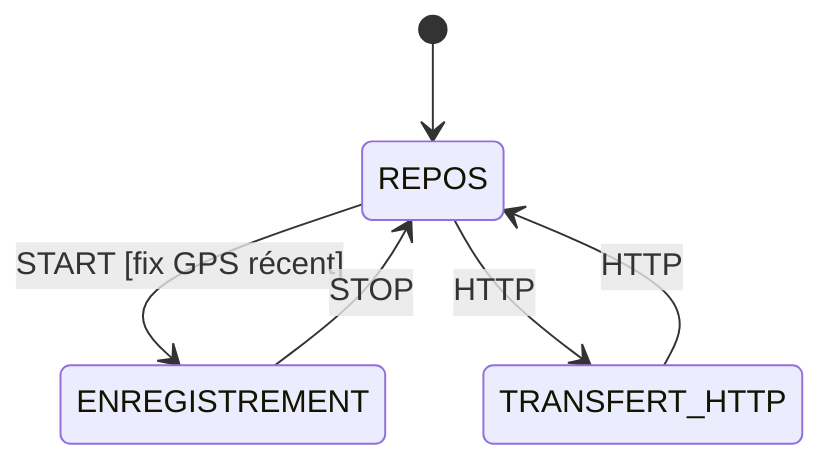
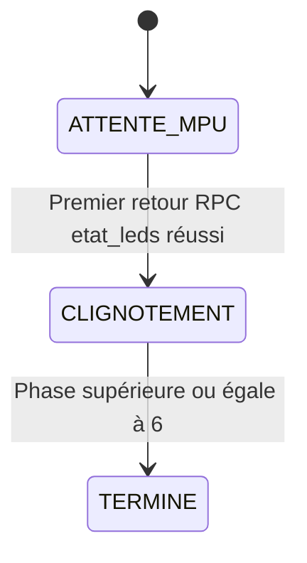

# Car_Traces — Enregistreur de trajets GPS avec Arduino UNO Q

> **Documentation française — 26 novembre 2026.** Le programme a fait l’objet d’essais fonctionnels et en conditions réelles, notamment la rotation à 20 fichiers GPX, la récupération après coupure d’alimentation et la reprise après interruption des données GPS.

## 1. Présentation

**Car_Traces** enregistre les trajets d'un véhicule au format **GPX 1.1** à l'aide d'une **Arduino UNO Q**, d'un récepteur GPS et d'un **Modulino Buttons**. Les traces sont stockées sur l'UNO Q et récupérables par un serveur HTTP activé à la demande.

Les fichiers GPX ainsi récupérés peuvent ensuite être exploités dans des outils compatibles, tels que [gpx.studio](https://gpx.studio/), afin de visualiser les trajets effectués sur une carte et d'en analyser les caractéristiques.

Ce projet illustre la collaboration entre les deux environnements de l'UNO Q :

- le **MCU**, programmé en C++, lit le GPS et les boutons et pilote les LED ;
- le **MPU**, sous Linux et programmé en Python avec Arduino App Lab, détient l'état de référence, applique la logique métier, écrit les GPX et gère le serveur HTTP.

Le principe architectural est volontairement simple : **le MCU détecte les événements et transmet les données ; le MPU prend les décisions applicatives ; le MCU affiche les informations d’état du MPU et assure localement la signalisation de fin d’initialisation.**

## 2. Matériel, raccordements et alimentation embarquée

### Matériel nécessaire

- Arduino **UNO Q** ;
- récepteur GPS fournissant des trames NMEA sur liaison série UART ;
- **Modulino Buttons** (trois boutons et trois LED) ;
- câble USB-C et adaptateur USB-A vers USB-C selon la connectique du véhicule ;
- boîtier destiné à recevoir et à protéger les différents composants ;
- Arduino App Lab et les bibliothèques utilisées dans le sketch : `TinyGPSPlus`, `Arduino_RouterBridge`, `Arduino_Modulino`.

### Raccordement du récepteur GPS

| Arduino UNO Q | Récepteur GPS |
|---|---|
| D0 (RX) | TX |
| D1 (TX) | RX |
| GND | GND |
| 3.3V | VCC |

Le sketch utilise `Serial1.begin(9600)` pour communiquer avec le récepteur GPS.

Le module GPS utilisé doit être compatible avec une alimentation et des niveaux logiques de 3,3 V.

### Raccordement du Modulino Buttons

Le Modulino Buttons est directement raccordé au connecteur Qwiic de l'Arduino UNO Q à l'aide d'un câble compatible.

La communication avec le MCU s'effectue par le bus I²C, initialisé par `Modulino.begin()`.

### Alimentation dans le véhicule

Car_Traces est conçu pour fonctionner de manière autonome à bord d'un véhicule, sans batterie supplémentaire ni connexion réseau pendant l'enregistrement des trajets.

L'alimentation de l'Arduino UNO Q s'effectue par son connecteur USB-C, à partir d'une prise USB du véhicule.

Deux configurations sont possibles :

| Connectique du véhicule | Raccordement |
|---|---|
| USB-A | Câble USB-C avec adaptateur USB-A vers USB-C |
| USB-C | Câble USB-C vers USB-C |

Cette solution permet d'utiliser le même enregistreur dans différents véhicules, indépendamment de leur connectique USB.

Il convient toutefois de vérifier que la prise USB du véhicule fournit une alimentation suffisante pour l'ensemble du montage. Si nécessaire, un adaptateur USB adapté à la prise accessoires 12 V du véhicule pourra être utilisé.

Car_Traces étant définie comme application par défaut (`DEFAULT`) dans Arduino App Lab, elle démarre automatiquement dès la mise sous tension de l'UNO Q.

Trois clignotements de la LED C signalent le premier échange RPC réussi avec `etat_leds`. L’utilisateur peut ensuite activer le serveur HTTP même sans fix GPS, ou démarrer un enregistrement à l’aide du bouton A dès que la LED B indique un fix récent.

### Précautions d'utilisation dans le véhicule

Il est recommandé de terminer l'enregistrement à l'aide du bouton B avant de couper l'alimentation de l'UNO Q.

En cas d'interruption brutale de l'alimentation, le mécanisme de réparation des fichiers GPX intervient au prochain démarrage de l'application, dans les conditions et avec les limites décrites au chapitre 8.

Le boîtier doit être installé de manière à permettre une réception GPS satisfaisante, sans gêner la conduite ni compromettre la sécurité des occupants.

**Importance de la qualité de l'alimentation et du câble USB**

Les essais réalisés ont mis en évidence l'importance de la qualité de la chaîne d'alimentation de l'Arduino UNO Q, notamment lors de son démarrage.

Il est fortement recommandé d'utiliser un câble USB d'excellente qualité, suffisamment dimensionné pour supporter le courant nécessaire, et de privilégier un câble court afin de limiter les chutes de tension.

En cas d'utilisation d'un adaptateur USB-A vers USB-C, celui-ci doit également être de bonne qualité.

Une alimentation insuffisante ou instable peut entraîner des redémarrages successifs de l'UNO Q et empêcher l'initialisation correcte de Car_Traces.

### Photographies de la réalisation

*Photographies du raccordement des composants, du montage dans son boîtier et de son installation dans le véhicule à ajouter après réalisation matérielle.*

## 3. Architecture MCU / MPU

```text
 Récepteur GPS (NMEA)                 Modulino Buttons
          |                                  |
          v                                  v
 +---------------------------------------------------+
 | MCU — sketch.ino                                  |
 | - Décode les trames GPS avec TinyGPSPlus          |
 | - Détecte les fronts d'appui sur A, B et C        |
 | - Envoie les données et commandes au MPU          |
 | - Affiche sur les LED l'état reçu du MPU          |
 | - Signale localement la fin d'initialisation      |
 +-----------------------+---------------------------+
                         | Arduino Bridge
                         v
 +---------------------------------------------------+
 | MPU — python/main.py                              |
 | - État applicatif et décisions START/STOP/HTTP    |
 | - Vérification du fix récent                      |
 | - Création, écriture et rotation des fichiers GPX |
 | - Réparation au démarrage des GPX non fermés      |
 | - Serveur HTTP de consultation et téléchargement  |
 +---------------------------------------------------+
```

### Échanges par Bridge

| Fonction Python exposée | Appelée par le MCU | Rôle |
|---|---|---|
| `update_gps(...)` | À la réception d'une position mise à jour et valide selon les contrôles du sketch | Met à jour les données GPS et écrit éventuellement un point |
| `bouton("START"/"STOP"/"HTTP")` | Sur un **front d'appui** | Demande une transition ; retourne le masque d’état métier |
| `etat_leds()` | Environ toutes les deux secondes | Retourne le masque d’état métier ; le premier retour réussi déclenche la signalisation locale |

Ces fonctions sont enregistrées avec `Bridge.provide(...)`, puis l'application Python lance `App.run()`.

## 4. Boutons, LED et logique métier

| Bouton | Commande | Action demandée au MPU | LED |
|---|---|---|---|
| **A** | `START` | Démarrer un enregistrement si le serveur HTTP est arrêté et si un fix GPS récent est disponible | A : enregistrement actif |
| **B** | `STOP` | Terminer l'enregistrement en écrivant les balises de fermeture GPX | B : **fix GPS récent**, et non état STOP |
| **C** | `HTTP` | Activer/désactiver le serveur HTTP si aucun enregistrement n'est actif | C : serveur HTTP actif en fonctionnement normal ; trois clignotements à l’initialisation |

**Attention :** en fonctionnement normal, les LED indiquent l'état de l'application et non l'état des boutons. En particulier, la LED B indique la disponibilité d'un fix GPS récent, indépendamment de la commande `STOP` associée au bouton B.

### Signalisation de fin d’initialisation

Au démarrage, les trois LED sont éteintes. Le premier retour réussi de l’appel RPC `etat_leds` déclenche trois clignotements de la LED C, indépendamment de la disponibilité du fix GPS. Ce signal confirme que le MCU a pu récupérer l’état du MPU ; il ne signifie pas que le serveur HTTP est déjà actif.

Après cette séquence, la LED C reprend sa fonction normale. Le serveur HTTP peut être activé sans fix GPS, à condition qu’aucun enregistrement ne soit en cours. Les LED A et B restent pilotées à partir des informations d’état mémorisées.

### Transitions autorisées

- **START** est refusé lorsque le serveur HTTP est actif ou lorsqu'aucun fix récent n'est disponible.
- **HTTP** est refusé pendant un enregistrement.
- **STOP** termine l'enregistrement actif ; sans enregistrement, la commande est sans effet.
- Un nouvel appui sur **HTTP** désactive le serveur lorsqu'il est déjà actif.

### Machine à états côté MPU

La logique métier de Car_Traces peut être représentée par une **machine à états finis** (*Finite State Machine*, FSM).

Contrairement à une implémentation classique utilisant une énumération (`enum`) et une variable représentant l’état courant, la machine métier du MPU utilise une **représentation implicite des états**.

Le mode de fonctionnement de l'application est directement déterminé par deux informations d'état :

- `_enreg["actif"]` : valeur booléenne associée à la clé `"actif"` du dictionnaire `_enreg`, indiquant si un enregistrement GPS est en cours ;
- `serveur` : variable contenant la référence au serveur HTTP lorsqu'il est actif, ou `None` lorsqu'il est arrêté.

#### Représentation des états

| État applicatif | `_enreg["actif"]` | `serveur` |
|---|---|---|
| REPOS | `False` | `None` |
| ENREGISTREMENT | `True` | `None` |
| TRANSFERT HTTP | `False` | Différent de `None` |
| État interdit | `True` | Différent de `None` |

La quatrième combinaison est interdite par la logique métier : l'enregistrement GPS et le serveur HTTP ne peuvent pas être simultanément actifs en fonctionnement normal.

#### Diagramme des transitions



Ce diagramme représente les transitions réussies. Les commandes refusées, les commandes sans effet et les erreurs d'exécution n'y sont pas représentées.

Il n'existe aucune transition directe entre les états ENREGISTREMENT et TRANSFERT HTTP. Le passage par l'état REPOS est obligatoire.

#### Gestion des événements et des transitions

La fonction Python `bouton(commande)` constitue le point d'entrée des événements issus des boutons du Modulino.

Elle reçoit l'une des trois commandes transmises par le MCU (`START`, `STOP` ou `HTTP`), examine l'état courant de l'application et applique les règles de transition.

Les fonctions `demarrer()`, `arreter()`, `demarrer_serveur()` et `arreter_serveur()` réalisent les opérations associées aux transitions.

Le verrou `_lock_commandes` assure la sérialisation du traitement des commandes, afin que deux transitions ne soient pas exécutées simultanément.

#### Comparaison avec une machine à états classique en C++

| Notion | Implémentation classique en C++ | Implémentation métier côté MPU |
|---|---|---|
| Définition des états | Énumération `enum` | Combinaisons de variables |
| État courant | Variable dédiée | `_enreg["actif"]` et `serveur` |
| Événement | Appui sur un bouton | Commande reçue par RPC |
| Traitement | Structure `switch/case` | Structures `if/elif/else` |
| Transition | Modification de la variable d'état | Modification des variables applicatives |
| Condition de transition | Condition logique | État courant et, pour START depuis REPOS, disponibilité d'un fix GPS récent |

L'absence d'une énumération et d'une variable d'état dédiée ne remet donc pas en cause le principe de la machine à états. Il s'agit d'un choix d'implémentation, indépendant du langage utilisé.

#### Particularité du fix GPS

La disponibilité d'un fix GPS récent constitue une information qui évolue indépendamment des trois modes de fonctionnement.

Elle intervient comme **condition de transition** de l'état REPOS vers l'état ENREGISTREMENT.

La perte du fix GPS pendant un enregistrement ne provoque pas de retour à l'état REPOS : l'enregistrement reste actif, mais aucun nouveau point n'est ajouté en l'absence de nouvelles données GPS répondant aux contrôles du programme.

#### Distinction entre machine à états et masque binaire

Le masque binaire renvoyé au MCU ne pilote pas la machine à états. Il représente les informations d'état calculées par le MPU afin de commander les trois LED du Modulino.

Il convient donc de distinguer :

- la **gestion des états et des transitions**, qui relève de la logique métier ;
- la **représentation des informations d'état**, qui permet leur transmission au MCU.

Le MCU ne reproduit pas la machine à états applicative. Il transmet les événements au MPU et gère l’affichage, avec une machine à états technique indépendante pour la signalisation de démarrage.

### Machine à états technique côté MCU

Cette machine ne décide ni de l’enregistrement ni du serveur HTTP. Elle gère exclusivement la séquence lumineuse de démarrage, à l’aide d’une énumération C++ et d’une variable d’état dédiée :

```cpp
enum EtatInitialisation {
  ATTENTE_MPU,
  CLIGNOTEMENT,
  TERMINE
};
EtatInitialisation initialisation = ATTENTE_MPU;
```

| État | Rôle |
|---|---|
| `ATTENTE_MPU` | Attend le premier résultat réussi de `etat_leds` |
| `CLIGNOTEMENT` | Pilote temporairement la LED C |
| `TERMINE` | Rétablit le fonctionnement normal jusqu’à la prochaine réinitialisation du MCU |



#### Déclenchement

Dans `synchroLeds()`, après un retour réussi de `Bridge.call("etat_leds").result(etat)`, le MCU mémorise le masque reçu puis exécute, uniquement si l’état courant est `ATTENTE_MPU` :

```cpp
if (initialisation == ATTENTE_MPU) {
  initialisation = CLIGNOTEMENT;
  debutClignotement = millis();
  Monitor.println("Car_Traces operationnel");
}
```

Le booléen retourné par `result()` indique la réussite de la récupération du résultat RPC, indépendamment de la valeur du masque.

#### Temporisation non bloquante et modulo

La fonction `signalerInitialisation()` est appelée à chaque passage dans `loop()`, après `lireBoutons()` et `synchroLeds()`. Elle retourne immédiatement si l’état n’est pas `CLIGNOTEMENT`.

```cpp
unsigned long ecoule = millis() - debutClignotement;
unsigned long phase = ecoule / PERIODE_CLIGNOTEMENT;
```

`PERIODE_CLIGNOTEMENT` vaut `200UL` (200 ms) et `NB_CLIGNOTEMENTS` vaut 3. La division entière découpe le temps en phases de 200 ms. `phase` est un indice sans unité ; le modulo `phase % 2` distingue les phases paires et impaires.

| Temps écoulé | Phase | Modulo 2 | LED C |
|---|---:|---:|---|
| 0–199 ms | 0 | 0 | Allumée |
| 200–399 ms | 1 | 1 | Éteinte |
| 400–599 ms | 2 | 0 | Allumée |
| 600–799 ms | 3 | 1 | Éteinte |
| 800–999 ms | 4 | 0 | Allumée |
| 1000–1199 ms | 5 | 1 | Éteinte |
| À partir de 1200 ms | ≥ 6 | — | État métier mémorisé |

```cpp
if (phase >= NB_CLIGNOTEMENTS * 2UL) {
  initialisation = TERMINE;
  afficherLeds(etatMPU);
  return;
}
```

La durée nominale est de 1 200 ms. Aucun `delay()` n’est utilisé : la boucle continue de traiter le GPS, les boutons et les échanges RPC. Les appels RPC synchrones peuvent toutefois retarder une itération et donc décaler ou faire manquer une phase lumineuse.

Une fois `TERMINE` atteint, la fonction reste appelée mais retourne immédiatement. La séquence ne recommence qu’après réinitialisation du MCU.

#### Deux machines à états complémentaires

| | MPU | MCU |
|---|---|---|
| Nature | Métier | Technique |
| Représentation | Implicite, variables Python | Explicite, `enum` C++ |
| Rôle | Enregistrement et serveur HTTP | Signalisation de démarrage |
| Évolution | Commandes et conditions métier | Premier retour RPC réussi puis temps écoulé |

Les deux machines sont indépendantes dans leurs responsabilités : le MPU reste la source de vérité métier.

### Pourquoi synchroniser les LED toutes les deux secondes ?

Après un appui, le MPU retourne immédiatement l'état des LED. Cependant, **la présence d'un fix GPS récent peut changer sans aucun appui**, par exemple à l'entrée ou à la sortie d'un tunnel. Une synchronisation périodique permet donc de mettre à jour la LED B et de rétablir la cohérence après un éventuel échec de communication.

Cette interrogation n’entraîne pas systématiquement une écriture sur le Modulino : `afficherLeds()` compare le masque à afficher à `dernierEtat` et n’appelle `buttons.setLeds(...)` **que lorsque ce masque change**. `memoriserEtat()` conserve le dernier masque reçu dans `etatMPU` (ou zéro en cas d’échec RPC) et ne l’affiche directement que hors clignotement.

### Comprendre le masque binaire

Le MPU encode les trois LED dans un seul entier :

| Bit | Valeur | Signification |
|---|---:|---|
| 0 | `1` | Enregistrement actif (LED A) |
| 1 | `2` | Fix GPS récent (LED B) |
| 2 | `4` | Serveur HTTP actif (LED C) |

Par exemple, `3 = 1 + 2` signifie « enregistrement actif et fix récent » ; `6 = 2 + 4` signifie « fix récent et serveur HTTP actif ». Le MCU décode ces informations avec `etat & 1`, `etat & 2` et `etat & 4`.

Les états où l'enregistrement et HTTP sont simultanément actifs ne sont pas prévus par la logique métier.

#### Masque métier et masque d’affichage

| Variable | Rôle |
|---|---|
| `etatMPU` | Dernier masque reçu du MPU, ou zéro en cas d’échec RPC |
| `dernierEtat` | Dernier masque appliqué aux LED |
| `etat` dans `signalerInitialisation()` | Masque local temporaire destiné à l’affichage |

Pendant le clignotement, le MCU construit un masque d’affichage sans modifier `etatMPU` :

```cpp
int etat = etatMPU & 3;
if (phase % 2 == 0) {
  etat |= 4;
}
afficherLeds(etat);
```

Le ET binaire avec `3` (`011`) conserve les bits A et B et efface le bit C. Le OU binaire avec `4` (`100`) force le bit C à 1 pendant les phases paires. `etat |= 4` équivaut à `etat = etat | 4`.

| Masque reçu | Après `& 3` | Phase paire (`\| 4`) | Phase impaire |
|---|---|---|---|
| `000` (0) | `000` | `100` (4) | `000` (0) |
| `010` (2) | `010` | `110` (6) | `010` (2) |
| `011` (3) | `011` | `111` (7) | `011` (3) |
| `110` (6) | `010` | `110` (6) | `010` (2) |

Lors d'un démarrage normal, en l'absence d'action de l'utilisateur sur les boutons, aucun enregistrement n'est actif et le serveur HTTP est arrêté. Les masques d'affichage possibles pendant la séquence d'initialisation sont donc `000`, `010`, `100` et `110`.

Toutefois, la lecture des boutons n'étant pas suspendue pendant cette séquence, une commande `START` acceptée pourrait exceptionnellement conduire à l'affichage temporaire des masques `101` ou `111`. Ces masques ne traduisent pas une activation simultanée de l'enregistrement et du serveur HTTP.

En cas d'échec RPC pendant la séquence, `etatMPU` devient zéro, mais la LED C peut continuer à clignoter jusqu'à la fin de celle-ci.

**Simulateur interactif (masques métier du MPU, hors signalisation de démarrage) :** [🎮 Simulateur interactif des masques binaires](https://philippe86220.github.io/Car_Traces/simulateur_bits.html). Le fichier HTML fonctionne localement dans un navigateur.

### Pour approfondir la gestion des boutons et des LED du Modulino

Un document complémentaire détaille les échanges entre le MCU et le MPU dans le cadre de la gestion du Modulino Buttons : transmission des commandes, appels RPC, valeurs de retour, construction et décodage des masques binaires, synchronisation des LED et gestion des verrous.

- [Comprendre les échanges MCU ↔ MPU liés au Modulino Buttons](docs/MCU_MPU_Communication.md)
  
## 5. Acquisition GPS et génération des GPX

Le MCU lit les octets reçus sur `Serial1` et les transmet au décodeur `TinyGPSPlus`. L'envoi au MPU intervient lorsque la position a été mise à jour et que la position, la date, l'heure, l'altitude, le nombre de satellites et le HDOP sont signalés comme valides.

Le MPU mémorise l'instant de réception d'une mise à jour avec `time.monotonic()`. Un **fix récent** est défini par `FIX_MAX_S = 3.0` secondes. Un démarrage d'enregistrement exige un tel fix.

Pendant un enregistrement, `PERIODE_S = 1.5` fixe **l'intervalle minimal entre deux points écrits**, à condition que de nouvelles données GPS arrivent. Ce réglage ne garantit pas un point exactement toutes les 1,5 secondes : la fréquence effective dépend notamment des trames reçues.

Chaque point contient latitude, longitude, altitude (`ele`), horodatage (`time`), nombre de satellites (`sat`) et HDOP (`hdop`). Les dates/heures GPS, reçues en UTC, sont converties en heure locale française avec `ZoneInfo("Europe/Paris")`, qui gère les changements d'heure saisonniers.

Exemple simplifié :

```xml
<trkpt lat="46.00000000" lon="0.00000000">
  <ele>100.00</ele>
  <time>2026-11-23T14:00:00+01:00</time>
  <sat>10</sat>
  <hdop>0.90</hdop>
</trkpt>
```

Les valeurs ci-dessus sont **fictives** et servent uniquement à illustrer la structure.

Une perte de réception GPS peut produire un **intervalle sans nouveaux points**, sans rendre pour autant le fichier XML invalide. Une position aberrante peut déformer le tracé même si le XML reste correctement formé ; l'application ne prétend pas corriger systématiquement les erreurs de positionnement satellite.

## 6. Stockage et rotation des fichiers

Les GPX sont stockés dans le dossier `data/gpx` de l'application, créé automatiquement si nécessaire. Les noms suivent le modèle `track_YYYYMMDD_HHMMSS.gpx` (date et heure **UTC**) ; un suffixe numéroté évite les collisions de noms.

`NB_FICHIERS_MAX = 20` limite le nombre de fichiers. **À la création d'un nouvel enregistrement**, la fonction `rotation()` supprime le ou les plus anciens fichiers nécessaires pour rester sous la limite. Il n'y a pas de suppression à chaque nouveau point GPS.

**Précaution :** récupérer régulièrement les trajets importants. La rotation supprime définitivement les fichiers les plus anciens ; il ne s'agit pas d'une sauvegarde.

## 7. Serveur HTTP et récupération des traces

Le serveur Python `ThreadingHTTPServer` écoute sur le **port 8000** et est **désactivé par défaut**. Le bouton C l'active ou le désactive. Le serveur ne peut pas être activé pendant un enregistrement. Aucun fix GPS n’est nécessaire pour l’activer.

Une fois le serveur activé, les fichiers GPX et les informations relatives à l'état de l'application sont accessibles depuis un ordinateur connecté au même réseau local que l'UNO Q.

Deux méthodes d'accès sont proposées :

- depuis un **navigateur web** (Firefox, Safari, Chrome, etc.) ;
- depuis un **terminal**, à l'aide de la commande `curl`.

Ces deux méthodes utilisent les mêmes routes HTTP.

### Routes HTTP disponibles

Dans les exemples suivants, remplacer `IP_UNO_Q` par l'adresse IP de l'UNO Q.

| URL | Fonction |
|---|---|
| `http://IP_UNO_Q:8000/` | Télécharge le dernier GPX terminé |
| `http://IP_UNO_Q:8000/interpret` | Sert ce GPX sans imposer son téléchargement |
| `http://IP_UNO_Q:8000/liste` | Renvoie la liste des fichiers GPX en JSON |
| `http://IP_UNO_Q:8000/gpx/NOM.gpx` | Télécharge le fichier désigné |
| `http://IP_UNO_Q:8000/etat` | Renvoie l'état de l'application et les dernières données GPS en JSON |

### 7.1. Utilisation depuis un navigateur web

Cette méthode ne nécessite aucune commande dans un terminal. Il suffit de saisir l'URL souhaitée dans la barre d'adresse du navigateur.

#### Télécharger le dernier trajet

```text
http://IP_UNO_Q:8000/
```

Le navigateur reçoit le dernier fichier GPX terminé avec une instruction de téléchargement. Le fichier conserve son nom d'origine, sous réserve du comportement et des paramètres du navigateur.

#### Consulter le contenu du dernier fichier GPX

```text
http://IP_UNO_Q:8000/interpret
```

Le serveur transmet le contenu XML du fichier GPX sans imposer son téléchargement. Le navigateur peut alors afficher son contenu ou le traiter selon sa configuration.

Cette route ne fournit pas une représentation cartographique du trajet.

#### Consulter la liste des fichiers disponibles

```text
http://IP_UNO_Q:8000/liste
```

Le navigateur affiche la liste des fichiers GPX disponibles au format JSON.

#### Télécharger un trajet précis

Après avoir repéré le nom du fichier souhaité dans la liste précédente, saisir par exemple :

```text
http://IP_UNO_Q:8000/gpx/track_20261123_103000.gpx
```

Le nom utilisé dans cet exemple est fictif : il doit être remplacé par un nom réellement présent dans la liste des fichiers disponibles.

#### Consulter l'état de l'application

```text
http://IP_UNO_Q:8000/etat
```

Cette route permet de consulter l'état de l'application et les dernières données GPS mémorisées par le MPU, au format JSON.

### 7.2. Utilisation depuis un terminal avec `curl`

L'utilisation de `curl` permet notamment de choisir le nom local du fichier téléchargé et d'automatiser la récupération des traces à l'aide de scripts.

Les commandes suivantes doivent être exécutées dans un terminal sur un ordinateur connecté au même réseau que l'UNO Q.

#### Télécharger le dernier trajet sous un nom choisi

```bash
curl -o trace.gpx http://IP_UNO_Q:8000/
```

L'option **`-o` (lettre o minuscule)** permet de choisir le nom local du fichier : ici `trace.gpx`.

Relancer cette commande remplace le fichier local existant du même nom, ce qui facilite son ouverture dans un logiciel de visualisation.

**Attention :** `-o` peut écraser un fichier local. Ne pas utiliser systématiquement le même nom si l'on souhaite conserver un historique des trajets.

La route `/` renvoie uniquement le dernier GPX terminé. Si plusieurs enregistrements ont été réalisés au cours d'un trajet, cette commande n'en récupère qu'un seul.

#### Télécharger le dernier trajet sous son nom d'origine

```bash
curl -OJ http://IP_UNO_Q:8000/
```

L'association des options `-O` et `-J` permet d'utiliser le nom de fichier communiqué par le serveur dans l'en-tête HTTP `Content-Disposition`.

#### Consulter la liste des fichiers disponibles

```bash
curl http://IP_UNO_Q:8000/liste
```

La liste des fichiers GPX est affichée dans le terminal au format JSON.

#### Télécharger un trajet précis sous son nom d'origine

Après avoir repéré le nom souhaité dans la liste JSON :

```bash
curl -O http://IP_UNO_Q:8000/gpx/track_20261123_103000.gpx
```

**Attention : `-O` est un O MAJUSCULE, et non un `-o` minuscule !**

L'option `-O` utilise le nom du fichier présent dans l'URL comme nom local (ici `track_20261123_103000.gpx`).

Avec `-o`, il faudrait préciser soi-même un nom local après l'option.

#### Consulter le contenu XML du dernier fichier GPX

```bash
curl http://IP_UNO_Q:8000/interpret
```

Le contenu XML du fichier GPX est affiché directement dans le terminal.

#### Consulter l'état de l'application

```bash
curl http://IP_UNO_Q:8000/etat
```

Les informations relatives à l'état de l'application et les dernières données GPS sont affichées dans le terminal au format JSON.

#### Particularité sous Windows

Sous Windows, on peut employer explicitement `curl.exe` à la place de `curl`.

Par exemple :

```bash
curl.exe -o trace.gpx http://IP_UNO_Q:8000/
```

### 7.3. Comparaison des deux méthodes

| Opération | Navigateur web | Terminal avec `curl` |
|---|---|---|
| Télécharger le dernier GPX | Oui | Oui |
| Télécharger un GPX précis | Oui | Oui |
| Consulter la liste des GPX | Oui | Oui |
| Consulter le contenu XML | Selon le comportement du navigateur | Oui |
| Consulter l'état de l'application | Oui | Oui |
| Choisir le nom local du fichier | Selon les paramètres du navigateur | Oui, avec `-o` |
| Automatiser les téléchargements par script | Non prévu dans cette procédure | Oui |

Le navigateur constitue la méthode la plus directe pour une utilisation ponctuelle. Le terminal offre davantage de souplesse, notamment pour choisir le nom des fichiers et automatiser leur récupération.

### 7.4. Particularités et précautions

**Adresse réseau :** `localhost` ne convient pas depuis un autre ordinateur, qu'il s'agisse d'un accès depuis un navigateur ou depuis un terminal. Cette adresse désigne toujours la machine sur laquelle le client HTTP est exécuté.

Depuis le système hôte Linux de l'UNO Q, il est possible d'utiliser `http://localhost:8000` lorsque le port est publié, comme expliqué au chapitre 9.

Depuis un autre appareil, utiliser l'adresse IP de l'UNO Q.

**Sélection des fichiers :** les routes `/` et `/interpret` sélectionnent le dernier fichier terminé, à l'exclusion du fichier en cours d'enregistrement. La route `/gpx/NOM.gpx`, quant à elle, ne comporte pas cette exclusion explicite dans le code ; en utilisation normale, le serveur HTTP et l'enregistrement sont mutuellement exclusifs.

**Sécurité :** le serveur écoute sur `0.0.0.0` et ne comporte pas d'authentification. Il est destiné à un réseau de confiance ; ne pas exposer directement son port sur Internet.

## 8. Réparation des fichiers après interruption

Au lancement de `main.py`, `reparer_gpx()` examine les fichiers `.gpx` :

1. Si la balise `</gpx>` apparaît à la fin du fichier, celui-ci est considéré comme fermé et n'est pas modifié.
2. Sinon, la fonction recherche la **dernière occurrence de `</trkpt>`**.
3. Si elle en trouve une, elle tronque le fichier juste après cette balise et ajoute les balises finales `</trkseg>`, `</trk>` et `</gpx>`.
4. Si aucun trackpoint complet n'est trouvé, elle signale le cas dans les journaux et laisse le fichier tel quel.

### Limites de la réparation

La fonction actuelle ne valide **pas** tous les points du document et ne protège pas contre toutes les formes de corruption. Elle modifie directement le fichier concerné et ne crée pas de copie de sauvegarde préalable. Les données non encore écrites durablement sur le stockage au moment d'une coupure ne peuvent pas être garanties récupérables.

Le mécanisme de réparation vise donc à récupérer les fichiers GPX non fermés à la suite d'une interruption brutale de l'application, sans pour autant garantir l'intégrité de l'ensemble des données enregistrées.

## 9. Configuration App Lab : `app.yaml`

```yaml
name: Car_Traces
description: "Enregistreur de trajets GPS au format GPX avec Arduino UNO Q"
ports:
  - 8000
bricks: []
icon: 🚗
```

La déclaration du port `8000` dans le fichier `app.yaml` permet à Arduino App Lab de publier le port du conteneur Docker sur le système Linux hôte de l'UNO Q.

Cette déclaration n'est pas nécessaire au démarrage du serveur HTTP Python à l'intérieur du conteneur, mais elle permet d'y accéder sans avoir à connaître l'adresse IP privée du conteneur.

Deux possibilités d'accès au serveur HTTP sont alors offertes :

- **Depuis l'UNO Q elle-même :** `http://localhost:8000`
- **Depuis un autre ordinateur connecté au réseau local :** `http://IP_UNO_Q:8000`

Dans le cadre de Car_Traces, l'UNO Q étant utilisée comme un enregistreur autonome embarqué dans un véhicule, l'utilisateur privilégiera la seconde méthode pour récupérer ses fichiers GPX depuis un autre ordinateur.

La publication effective du port peut être vérifiée depuis un terminal de l'UNO Q avec la commande :

```bash
docker ps --format "table {{.Names}}\t{{.Ports}}"
```

Résultat constaté :

```text
0.0.0.0:8000->8000/tcp, :::8000->8000/tcp
```

Ce résultat confirme la publication du port `8000` sur les interfaces IPv4 et IPv6 de l'UNO Q.

Il convient toutefois de distinguer la publication du port par Docker du démarrage effectif du serveur HTTP : ce dernier n'est actif qu'après son activation à l'aide du bouton C du Modulino Buttons.

## 10. Installation et mise en service

### 10.1. Installation de l'application

1. Télécharger le dépôt [Car_Traces](https://github.com/philippe86220/Car_Traces) depuis GitHub au format ZIP.
2. Importer l'application dans Arduino App Lab.
3. Vérifier la disponibilité des bibliothèques nécessaires au sketch, dont les dépendances sont déclarées dans le fichier `sketch.yaml`.
4. Raccorder le GPS et le Modulino Buttons conformément aux raccordements décrits au chapitre 2.
5. Lancer l'application dans Arduino App Lab.
6. Définir **Car_Traces** comme application par défaut (`DEFAULT`) afin qu'elle démarre automatiquement à chaque mise sous tension de l'UNO Q.

### 10.2. Utilisation autonome

Une fois l'application installée et définie comme application par défaut, l'UNO Q fonctionne de manière autonome. L'utilisateur n'a plus besoin d'intervenir dans Arduino App Lab pour enregistrer ses trajets ou récupérer ses fichiers GPX.

Aucune connexion réseau n'est nécessaire pendant l'enregistrement des trajets.

#### Démarrage

- Mettre l'UNO Q sous tension.
- Attendre la fin des trois clignotements de la LED C, signalant le premier retour RPC réussi de `etat_leds()`.

#### Enregistrement d'un trajet

- Attendre l'allumage de la LED B, indiquant la disponibilité d'un fix GPS récent.
- Appuyer sur le bouton **A** pour démarrer un enregistrement.
- Vérifier l'allumage de la LED A, confirmant que l'enregistrement est actif.
- Appuyer sur le bouton **B** pour terminer l'enregistrement.
- Vérifier l'extinction de la LED A.

#### Récupération et visualisation des trajets

- Appuyer sur le bouton **C** pour activer le serveur HTTP.
- Vérifier l'allumage de la LED C.
- Récupérer les fichiers GPX depuis un autre ordinateur connecté au même réseau local que l'UNO Q, selon l'une des méthodes décrites au chapitre 7.
- Appuyer de nouveau sur le bouton **C** pour désactiver le serveur HTTP.
- Vérifier l'extinction de la LED C.

Contrairement à l'enregistrement d'un trajet, la récupération des fichiers GPX ne nécessite pas de fix GPS récent.

Les fichiers récupérés peuvent ensuite être exploités dans un outil compatible, tel que [gpx.studio](https://gpx.studio/), afin de visualiser les trajets sur une carte et d'en analyser les caractéristiques.

### 10.3. Gestion et maintenance des fichiers GPX

Le programme Python crée automatiquement le dossier `data/gpx` et tente, à chaque démarrage de l'application, de réparer les fichiers GPX non fermés, dans les conditions et avec les limites décrites au chapitre 8.

Arduino App Lab permet également d'effectuer manuellement certaines opérations sur les fichiers GPX présents dans ce dossier :

- consulter leur contenu XML ;
- récupérer leur contenu par copier-coller ;
- supprimer des fichiers.

Ces opérations de maintenance restent facultatives et doivent être réalisées en dehors d'un enregistrement.

Le principe de Car_Traces repose sur une utilisation autonome de l'UNO Q : le Modulino Buttons constitue l'interface matérielle de commande de l'application, tandis que le serveur HTTP permet la récupération des traces sans avoir à utiliser Arduino App Lab.
## 11. Vérifications réalisées et validation en conditions réelles

**Vérifications déjà rapportées :** acquisition GPS et création de traces, lecture dans un outil de visualisation GPX, fonctionnement des commandes et des LED, téléchargement HTTP depuis une autre machine, consultation de `/liste` et récupération d’un GPX précis avec `-O`, réparation d'un fichier volontairement tronqué et rotation à **20 GPX**.

Le démarrage automatique de Car_Traces, définie comme application par défaut (`DEFAULT`) dans Arduino App Lab, a également été validé. L'application redémarre automatiquement lors de la mise sous tension de l'UNO Q, qu'elle ait été laissée active ou arrêtée manuellement avant l'arrêt de la carte.

**Essais en conditions réelles du 26 novembre 2026 :**

- Trajet normal : enregistrement et récupération GPX conformes.
- Coupure brutale de l’alimentation USB : récupération du fichier avec ajout des balises finales après redémarrage.
- Interruption temporaire des données GPS : absence de nouveaux points pendant l’interruption et reprise automatique à leur retour. Un logiciel de visualisation peut relier les deux positions encadrant l’interruption par une ligne droite, sans que Car_Traces ait créé de points intermédiaires.
- Signalisation de démarrage : fonctionnement du sketch intégrant le clignotement confirmé par un nouvel essai en conditions réelles.
- Alimentation : des difficultés de démarrage avec une configuration domestique ont disparu après changement de la chaîne d’alimentation. Le rôle respectif du câble et du bloc n’a pas été isolé.

Ne pas réaliser de manipulation électrique pendant la conduite.

## 12. Intérêt pédagogique

Car_Traces réunit plusieurs notions : UART/NMEA, TinyGPSPlus, I²C et périphériques Modulino, détection de fronts d'appui, échanges interprocesseurs avec Bridge, séparation entre acquisition matérielle et logique métier, machines à états finis à représentation implicite (MPU) et explicite (MCU), conditions de transition, synchronisation d’état, distinction entre masque métier et masque d’affichage, opérations binaires, division entière, modulo et temporisation non bloquante avec `millis()`, concurrence et verrous Python, serveur HTTP, XML/GPX, fuseaux horaires, rotation et récupération de fichiers.

La leçon centrale est la **répartition explicite des responsabilités** : le MCU assure l'interface matérielle, et la signalisation technique locale, tandis que le MPU reste la source de vérité et prend les décisions métier.

## 13. Crédits

**Projet porté par P. COSTES :** idée, réalisation matérielle, intégration sur Arduino UNO Q, essais et validation en conditions réelles.

**Développement en collaboration avec ChatGPT (OpenAI) :** échanges sur l’architecture MCU/MPU, conception et analyse de la logique applicative, assistance à l’écriture et à la révision du code C++ et Python, recherche de solutions aux problèmes rencontrés, préparation des scénarios de test et rédaction de la documentation. Les propositions ont été examinées et éprouvées sur le matériel par P. COSTES.

**Simulateur pédagogique des masques binaires :** réalisé avec l’assistance de ChatGPT (OpenAI).

---

*Documentation française destinée à être relue avant traduction anglaise et présentation sur le forum Arduino.*
