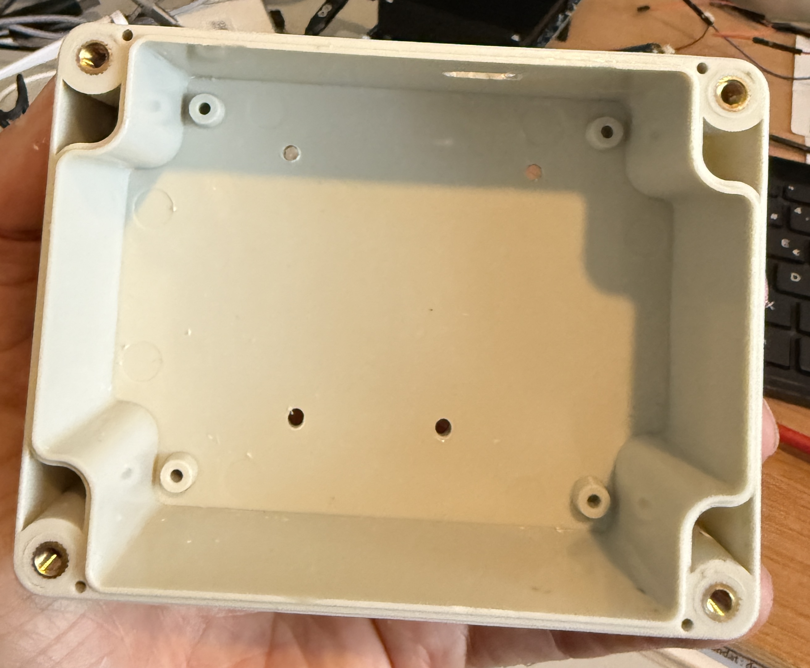
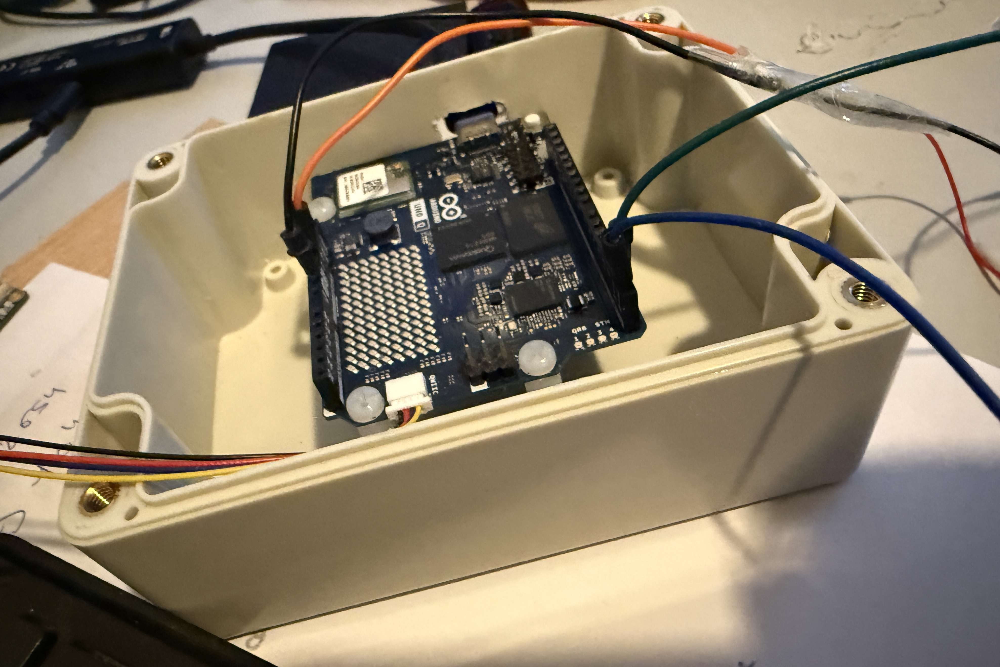
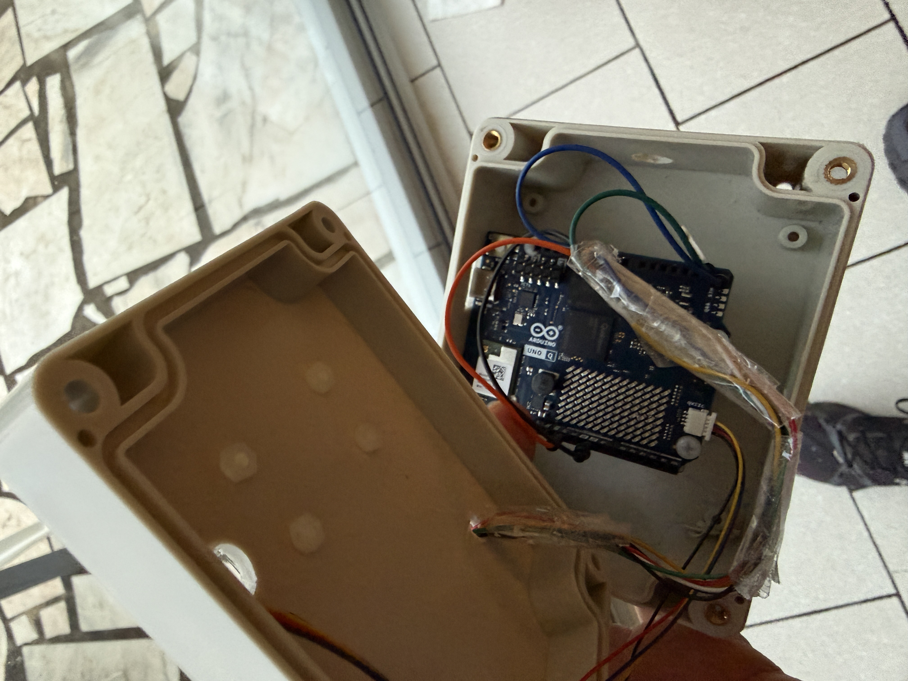
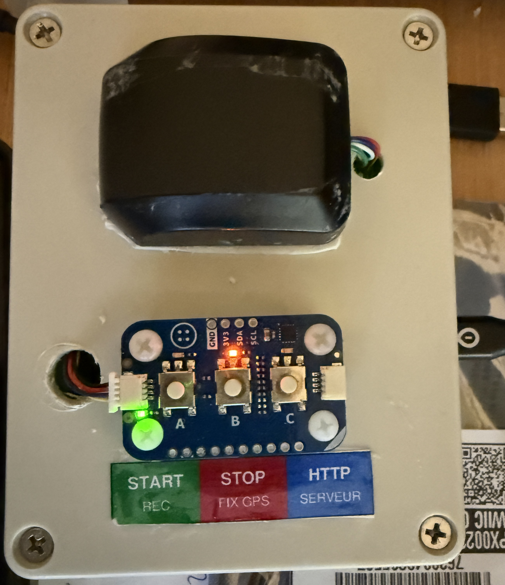
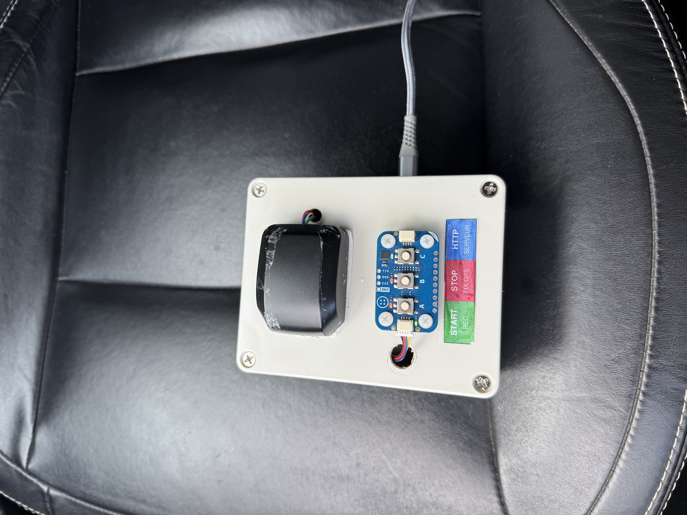
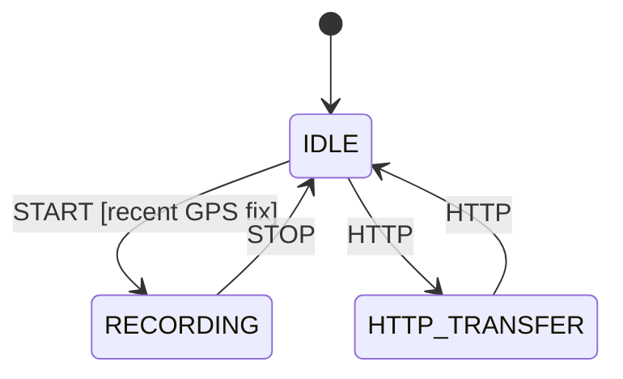
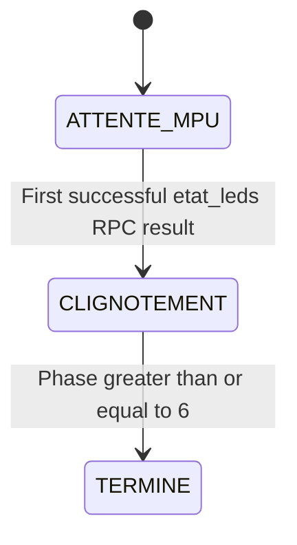

[🇫🇷 Documentation française](README_FR.md)

# Car_Traces — GPS trip logger with Arduino UNO Q

> **English documentation — 27 November 2026.** The application has undergone functional and real-world testing, including rotation of 20 GPX files, recovery after power loss, and resumption after an interruption in GPS data.

## 1. Overview

**Car_Traces** records vehicle trips in **GPX 1.1** format using an **Arduino UNO Q**, a GPS receiver and a **Modulino Buttons** module. Tracks are stored on the UNO Q and can be retrieved through an HTTP server enabled on demand.

The retrieved GPX files can then be used in compatible tools such as [gpx.studio](https://gpx.studio/) to display trips on a map and analyse their characteristics.

This project illustrates cooperation between the two environments of the UNO Q:

- the **MCU**, programmed in C++, reads the GPS receiver and buttons and controls the LEDs;
- the **MPU**, running Linux and programmed in Python with Arduino App Lab, maintains the authoritative application state, implements the application logic, writes GPX files and manages the HTTP server.

The architectural principle is deliberately simple: **the MCU detects events and transmits data; the MPU makes application-level decisions; the MCU displays the MPU state information and locally signals the completion of initialisation.**

## 2. Hardware, wiring and in-vehicle power supply

### Required hardware and software

- Arduino **UNO Q**;
- GPS receiver providing NMEA sentences over a UART serial connection;
- **Modulino Buttons** (three buttons and three LEDs);
- USB-C cable and USB-A to USB-C adapter, depending on the vehicle's connectors;
- enclosure to house and protect the components;
- Arduino App Lab and the libraries used by the sketch: `TinyGPSPlus`, `Arduino_RouterBridge`, `Arduino_Modulino`.

### Connecting the GPS receiver

| Arduino UNO Q | GPS receiver |
|---|---|
| D0 (RX) | TX |
| D1 (TX) | RX |
| GND | GND |
| 3.3V | VCC |

The sketch uses `Serial1.begin(9600)` to communicate with the GPS receiver.

The GPS module must support a 3.3 V power supply and 3.3 V logic levels.

### Connecting the Modulino Buttons

The Modulino Buttons is connected directly to the Arduino UNO Q's Qwiic connector using a compatible cable.

Communication with the MCU takes place over the I²C bus, initialised by `Modulino.begin()`.

### In-vehicle power supply

Car_Traces is designed to operate autonomously in a vehicle, without an additional battery or a network connection while recording trips.

The Arduino UNO Q is powered through its USB-C connector from a USB port in the vehicle.

Two configurations are possible:

| Vehicle connector | Connection |
|---|---|
| USB-A | USB-C cable with a USB-A to USB-C adapter |
| USB-C | USB-C to USB-C cable |

This allows the same logger to be used in different vehicles regardless of their USB connector type.

However, check that the vehicle's USB port provides sufficient power for the entire assembly. If necessary, a suitable USB power adapter connected to the vehicle's 12 V accessory socket can be used.

When Car_Traces is set as the default application (`DEFAULT`) in Arduino App Lab, it starts automatically whenever the UNO Q is powered on.

Three flashes of LED C indicate the first successful RPC exchange with `etat_leds`. The user can then enable the HTTP server even without a GPS fix, or start recording using button A as soon as LED B indicates a recent fix.

### Precautions for in-vehicle use

It is recommended to stop recording using button B before disconnecting power from the UNO Q.

If power is abruptly interrupted, the GPX file repair mechanism runs the next time the application starts, subject to the conditions and limitations described in section 8.

The enclosure must be positioned to allow satisfactory GPS reception without interfering with driving or compromising occupant safety.

**Importance of power supply and USB cable quality**

Testing highlighted the importance of the quality of the Arduino UNO Q's power delivery chain, particularly during startup.

A high-quality USB cable rated for the required current is strongly recommended. Prefer a short cable to minimise voltage drops.

If a USB-A to USB-C adapter is used, it should also be of good quality.

An insufficient or unstable power supply can cause repeated UNO Q restarts and prevent Car_Traces from initialising correctly.

**Mechanical protection of the USB-C connector**

To reduce wear on the Arduino UNO Q's USB-C connector, it is recommended to leave a good-quality USB cable permanently connected to the board and connect or disconnect it at the power supply end.

Mechanically securing the cable to the enclosure also reduces strain on the connector, particularly while the vehicle is moving.

### Build photographs

The following photographs illustrate the different stages of the Car_Traces hardware assembly, from preparing the enclosure to using the device in a vehicle.

#### Preparing the enclosure



#### Mounting the Arduino UNO Q



#### Assembling the components



#### Completed enclosure with control label



#### In-vehicle use



### Modulino Buttons label

A sheet of colour labels is available in PDF format:

- [Download the Car_Traces labels](docs/Car_Traces_etiquettes_couleur.pdf)

The label dimensions and layout can be freely adapted to suit the enclosure and individual preferences.

## 3. MCU / MPU architecture

```text
 GPS receiver (NMEA)                  Modulino Buttons
          |                                  |
          v                                  v
 +---------------------------------------------------+
 | MCU — sketch.ino                                  |
 | - Decodes GPS sentences using TinyGPSPlus         |
 | - Detects button press edges on A, B and C        |
 | - Sends data and commands to the MPU              |
 | - Displays the MPU state on the LEDs              |
 | - Locally signals completion of initialisation    |
 +-----------------------+---------------------------+
                         | Arduino Bridge
                         v
 +---------------------------------------------------+
 | MPU — python/main.py                              |
 | - Application state and START/STOP/HTTP decisions |
 | - Checks for a recent GPS fix                     |
 | - Creates, writes and rotates GPX files           |
 | - Repairs unclosed GPX files at startup           |
 | - HTTP server for viewing and downloading files   |
 +---------------------------------------------------+
```

### Communication through Bridge

| Exposed Python function | Called by the MCU | Purpose |
|---|---|---|
| `update_gps(...)` | When an updated position meeting the sketch's validity checks is received | Updates GPS data and writes a trackpoint when appropriate |
| `bouton("START"/"STOP"/"HTTP")` | On a **button press edge** | Requests a transition; returns the application state bitmask |
| `etat_leds()` | Approximately every two seconds | Returns the application state bitmask; the first successful result triggers local startup signalling |

These functions are registered using `Bridge.provide(...)`, after which the Python application calls `App.run()`.

## 4. Buttons, LEDs and application logic

| Button | Command | Action requested from the MPU | LED |
|---|---|---|---|
| **A** | `START` | Start recording if the HTTP server is stopped and a recent GPS fix is available | A: recording active |
| **B** | `STOP` | Stop recording by writing the GPX closing tags | B: **recent GPS fix**, not STOP status |
| **C** | `HTTP` | Toggle the HTTP server if no recording is active | C: HTTP server active during normal operation; three flashes at initialisation |

**Note:** during normal operation, the LEDs indicate the application state, not the button states. In particular, LED B indicates the availability of a recent GPS fix, independently of the `STOP` command associated with button B.

### Signalling completion of initialisation

At startup, all three LEDs are off. The first successful result of the `etat_leds` RPC call triggers three flashes of LED C, regardless of GPS fix availability. This signal confirms that the MCU has successfully retrieved the MPU state; it does not mean that the HTTP server is already active.

After this sequence, LED C resumes its normal function. The HTTP server can be enabled without a GPS fix, provided no recording is in progress. LEDs A and B continue to be controlled using the stored state information.

### Allowed transitions

- **START** is rejected when the HTTP server is active or no recent fix is available.
- **HTTP** is rejected during recording.
- **STOP** ends the active recording; if no recording is active, the command has no effect.
- Pressing **HTTP** again disables the server if it is already active.

### MPU application state machine

The application logic of Car_Traces can be represented as a **finite state machine** (FSM).

Unlike a conventional implementation using an enumeration (`enum`) and a variable representing the current state, the MPU application state machine uses an **implicit state representation**.

The operating mode of the application is directly determined by two pieces of state information:

- `_enreg["actif"]`: the Boolean value associated with the `"actif"` key in the `_enreg` dictionary, indicating whether GPS recording is in progress;
- `serveur`: a variable holding a reference to the HTTP server when active, or `None` when stopped.

#### State representation

| Application state | `_enreg["actif"]` | `serveur` |
|---|---|---|
| IDLE | `False` | `None` |
| RECORDING | `True` | `None` |
| HTTP TRANSFER | `False` | Not `None` |
| Forbidden state | `True` | Not `None` |

The fourth combination is forbidden by the application logic: GPS recording and the HTTP server cannot be active simultaneously during normal operation.

#### State transition diagram



This diagram represents successful transitions. Rejected commands, commands with no effect and execution errors are not shown.

There is no direct transition between RECORDING and HTTP TRANSFER. The application must pass through the IDLE state.

#### Handling events and transitions

The Python function `bouton(commande)` is the entry point for events originating from the Modulino buttons.

It receives one of the three commands transmitted by the MCU (`START`, `STOP` or `HTTP`), examines the current application state and applies the transition rules.

The functions `demarrer()`, `arreter()`, `demarrer_serveur()` and `arreter_serveur()` perform the operations associated with the transitions.

The `_lock_commandes` lock serialises command processing so that two transitions cannot be executed simultaneously.

#### Comparison with a conventional C++ state machine

| Concept | Conventional C++ implementation | MPU application implementation |
|---|---|---|
| State definition | `enum` enumeration | Combinations of variables |
| Current state | Dedicated variable | `_enreg["actif"]` and `serveur` |
| Event | Button press | Command received via RPC |
| Processing | `switch/case` structure | `if/elif/else` structures |
| Transition | Modification of the state variable | Modification of application variables |
| Transition condition | Logical condition | Current state and, for START from IDLE, availability of a recent GPS fix |

The absence of an enumeration and a dedicated state variable does not invalidate the state machine concept. It is an implementation choice, independent of the programming language used.

#### The particular role of the GPS fix

The availability of a recent GPS fix changes independently of the three operating modes.

It acts as a **transition condition** from IDLE to RECORDING.

Loss of the GPS fix during recording does not cause a return to IDLE: recording remains active, but no new trackpoints are added in the absence of new GPS data meeting the program's checks.

#### Distinguishing the state machine from the bitmask

The bitmask returned to the MCU does not control the state machine. It represents state information computed by the MPU to control the three Modulino LEDs.

It is therefore important to distinguish between:

- **state and transition management**, which belongs to the application logic;
- **representation of state information**, which enables its transmission to the MCU.

The MCU does not replicate the application state machine. It forwards events to the MPU and manages the display, with a separate technical state machine for startup signalling.

### MCU technical state machine

This state machine makes no decisions about recording or the HTTP server. It exclusively manages the startup LED sequence using a C++ enumeration and a dedicated state variable:

```cpp
enum EtatInitialisation {
  ATTENTE_MPU,
  CLIGNOTEMENT,
  TERMINE
};

EtatInitialisation initialisation = ATTENTE_MPU;
```

| State | Purpose |
|---|---|
| `ATTENTE_MPU` | Waits for the first successful result from `etat_leds` |
| `CLIGNOTEMENT` | Temporarily controls LED C |
| `TERMINE` | Restores normal operation until the next MCU reset |



#### Triggering the sequence

In `synchroLeds()`, following a successful result from `Bridge.call("etat_leds").result(etat)`, the MCU stores the received bitmask and then executes the following code only if the current state is `ATTENTE_MPU`:

```cpp
if (initialisation == ATTENTE_MPU) {
  initialisation = CLIGNOTEMENT;
  debutClignotement = millis();
  Monitor.println("Car_Traces operationnel");
}
```

The Boolean returned by `result()` indicates whether the RPC result was successfully retrieved, regardless of the bitmask value.

#### Non-blocking timing and modulo

The function `signalerInitialisation()` is called on every iteration of `loop()`, after `lireBoutons()` and `synchroLeds()`. It returns immediately if the state is not `CLIGNOTEMENT`.

```cpp
unsigned long ecoule = millis() - debutClignotement;
unsigned long phase = ecoule / PERIODE_CLIGNOTEMENT;
```

`PERIODE_CLIGNOTEMENT` is `200UL` (200 ms), and `NB_CLIGNOTEMENTS` is 3. Integer division divides elapsed time into 200 ms phases. `phase` is a dimensionless index; the modulo operation `phase % 2` distinguishes even and odd phases.

| Elapsed time | Phase | Modulo 2 | LED C |
|---|---:|---:|---|
| 0–199 ms | 0 | 0 | On |
| 200–399 ms | 1 | 1 | Off |
| 400–599 ms | 2 | 0 | On |
| 600–799 ms | 3 | 1 | Off |
| 800–999 ms | 4 | 0 | On |
| 1000–1199 ms | 5 | 1 | Off |
| From 1200 ms | ≥ 6 | — | Stored application state |

```cpp
if (phase >= NB_CLIGNOTEMENTS * 2UL) {
  initialisation = TERMINE;
  afficherLeds(etatMPU);
  return;
}
```

The nominal duration is 1,200 ms. No `delay()` is used: the loop continues to process GPS data, buttons and RPC exchanges. However, synchronous RPC calls can delay an iteration and consequently delay or skip a flashing phase.

Once `TERMINE` is reached, the function continues to be called but returns immediately. The sequence only restarts after an MCU reset.

#### Two complementary state machines

| | MPU | MCU |
|---|---|---|
| Nature | Application-level | Technical |
| Representation | Implicit, Python variables | Explicit, C++ `enum` |
| Purpose | Recording and HTTP server | Startup signalling |
| Progression | Commands and application conditions | First successful RPC result, then elapsed time |

The two state machines have independent responsibilities: the MPU remains the authoritative source of application state.

### Why synchronise the LEDs every two seconds?

After a button press, the MPU immediately returns the LED state. However, **the availability of a recent GPS fix can change without any button press**, for example when entering or leaving a tunnel. Periodic synchronisation therefore updates LED B and restores consistency after a possible communication failure.

This polling does not necessarily result in a write to the Modulino: `afficherLeds()` compares the bitmask to be displayed with `dernierEtat` and calls `buttons.setLeds(...)` **only when that bitmask changes**. `memoriserEtat()` stores the last received bitmask in `etatMPU` (or zero if the RPC fails) and displays it directly only outside the flashing sequence.

### Understanding the bitmask

The MPU encodes the three LEDs in a single integer:

| Bit | Value | Meaning |
|---|---:|---|
| 0 | `1` | Recording active (LED A) |
| 1 | `2` | Recent GPS fix (LED B) |
| 2 | `4` | HTTP server active (LED C) |

For example, `3 = 1 + 2` means “recording active and recent fix”; `6 = 2 + 4` means “recent fix and HTTP server active”. The MCU decodes this information using `etat & 1`, `etat & 2` and `etat & 4`.

States in which recording and HTTP are simultaneously active are not allowed by the application logic.

#### Application state bitmask and display bitmask

| Variable | Purpose |
|---|---|
| `etatMPU` | Last bitmask received from the MPU, or zero if the RPC fails |
| `dernierEtat` | Last bitmask applied to the LEDs |
| `etat` in `signalerInitialisation()` | Temporary local display bitmask |

During the flashing sequence, the MCU constructs a display bitmask without modifying `etatMPU`:

```cpp
int etat = etatMPU & 3;
if (phase % 2 == 0) {
  etat |= 4;
}
afficherLeds(etat);
```

Bitwise AND with `3` (`011`) preserves bits A and B and clears bit C. Bitwise OR with `4` (`100`) sets bit C to 1 during even phases. `etat |= 4` is equivalent to `etat = etat | 4`.

| Received bitmask | After `& 3` | Even phase (`\| 4`) | Odd phase |
|---|---|---|---|
| `000` (0) | `000` | `100` (4) | `000` (0) |
| `010` (2) | `010` | `110` (6) | `010` (2) |
| `011` (3) | `011` | `111` (7) | `011` (3) |
| `110` (6) | `010` | `110` (6) | `010` (2) |

During normal startup, if the user does not press any buttons, no recording is active and the HTTP server is stopped. The possible display bitmasks during initialisation are therefore `000`, `010`, `100` and `110`.

However, since button polling is not suspended during this sequence, an accepted `START` command could exceptionally result in the temporary display of bitmasks `101` or `111`. These bitmasks do not indicate simultaneous activation of recording and the HTTP server.

If an RPC fails during the sequence, `etatMPU` becomes zero, but LED C may continue flashing until the sequence ends.

**Interactive simulator (MPU application state bitmasks, excluding startup signalling):** [🎮 Interactive bitmask simulator](https://philippe86220.github.io/Car_Traces/simulateur_bits.html). The HTML file runs locally in a browser.

### Further reading on Modulino button and LED management

A companion document describes MCU–MPU communication in the context of Modulino Buttons management: command transmission, RPC calls, return values, bitmask construction and decoding, LED synchronisation and lock management.

- [Understanding MCU ↔ MPU communication for Modulino Buttons](docs/MCU_MPU_Communication.md)

## 5. GPS acquisition and GPX generation

The MCU reads bytes received on `Serial1` and passes them to the `TinyGPSPlus` decoder. Data is sent to the MPU when the position has been updated and the position, date, time, altitude, satellite count and HDOP are reported as valid.

The MPU records the time at which an update is received using `time.monotonic()`. A **recent fix** is defined by `FIX_MAX_S = 3.0` seconds. Starting a recording requires such a fix.

During recording, `PERIODE_S = 1.5` sets the **minimum interval between two written trackpoints**, provided new GPS data arrives. This setting does not guarantee a point exactly every 1.5 seconds: the actual frequency depends, among other things, on the received NMEA sentences.

Each point contains latitude, longitude, elevation (`ele`), timestamp (`time`), satellite count (`sat`) and HDOP (`hdop`). GPS dates and times, received in UTC, are converted to French local time using `ZoneInfo("Europe/Paris")`, which handles seasonal clock changes.

Simplified example:

```xml
<trkpt lat="46.00000000" lon="0.00000000">
  <ele>100.00</ele>
  <time>2026-11-23T14:00:00+01:00</time>
  <sat>10</sat>
  <hdop>0.90</hdop>
</trkpt>
```

The values above are **fictitious** and are provided solely to illustrate the structure.

Loss of GPS reception can result in a **gap with no new trackpoints**, without making the XML file invalid. An erroneous position can distort the track even if the XML remains well-formed; the application does not claim to systematically correct satellite positioning errors.

## 6. File storage and rotation

GPX files are stored in the application's `data/gpx` directory, which is created automatically if necessary. Filenames follow the pattern `track_YYYYMMDD_HHMMSS.gpx` (**UTC** date and time); a numbered suffix prevents filename collisions.

`NB_FICHIERS_MAX = 20` limits the number of files. **When a new recording is created**, the `rotation()` function deletes as many of the oldest files as necessary to stay within the limit. No deletion takes place each time a new GPS point is written.

**Precaution:** retrieve important trips regularly. Rotation permanently deletes the oldest files; it is not a backup mechanism.

## 7. HTTP server and track retrieval

The Python `ThreadingHTTPServer` listens on **port 8000** and is **disabled by default**. Button C enables or disables it. The server cannot be enabled during recording. No GPS fix is required to enable it.

Once the server is enabled, GPX files and application state information can be accessed from a computer connected to the same local network as the UNO Q.

Two access methods are available:

- from a **web browser** (Firefox, Safari, Chrome, etc.);
- from a **terminal**, using the `curl` command.

Both methods use the same HTTP routes.

### Available HTTP routes

In the following examples, replace `IP_UNO_Q` with the IP address of the UNO Q.

| URL | Function |
|---|---|
| `http://IP_UNO_Q:8000/` | Downloads the latest completed GPX file |
| `http://IP_UNO_Q:8000/interpret` | Serves that GPX file without forcing a download |
| `http://IP_UNO_Q:8000/liste` | Returns the list of GPX files as JSON |
| `http://IP_UNO_Q:8000/gpx/NOM.gpx` | Downloads the specified file |
| `http://IP_UNO_Q:8000/etat` | Returns application state and the latest GPS data as JSON |

### 7.1. Using a web browser

This method requires no terminal commands. Simply enter the desired URL in the browser's address bar.

#### Downloading the latest trip

```text
http://IP_UNO_Q:8000/
```

The browser receives the latest completed GPX file with a download instruction. The file retains its original name, subject to the browser's behaviour and settings.

#### Viewing the contents of the latest GPX file

```text
http://IP_UNO_Q:8000/interpret
```

The server sends the XML contents of the GPX file without forcing a download. The browser can then display or process the contents according to its configuration.

This route does not provide a map representation of the trip.

#### Viewing the list of available files

```text
http://IP_UNO_Q:8000/liste
```

The browser displays the list of available GPX files in JSON format.

#### Downloading a specific trip

After identifying the desired filename in the preceding list, enter, for example:

```text
http://IP_UNO_Q:8000/gpx/track_20261123_103000.gpx
```

The filename used in this example is fictitious: replace it with a filename actually present in the list of available files.

#### Viewing the application state

```text
http://IP_UNO_Q:8000/etat
```

This route provides the application state and the latest GPS data stored by the MPU, in JSON format.

### 7.2. Using a terminal with `curl`

Using `curl` allows you to choose the local filename for a download and automate track retrieval using scripts.

The following commands must be executed in a terminal on a computer connected to the same network as the UNO Q.

#### Downloading the latest trip under a chosen filename

```bash
curl -o trace.gpx http://IP_UNO_Q:8000/
```

The **`-o` option (lowercase letter o)** lets you choose the local filename: here, `trace.gpx`.

Running this command again replaces an existing local file with the same name, making it easier to open in a visualisation tool.

**Warning:** `-o` can overwrite a local file. Do not always use the same filename if you wish to retain a trip history.

The `/` route returns only the latest completed GPX file. If several recordings were made during a trip, this command retrieves only one of them.

#### Downloading the latest trip under its original filename

```bash
curl -OJ http://IP_UNO_Q:8000/
```

Combining the `-O` and `-J` options allows the filename supplied by the server in the `Content-Disposition` HTTP header to be used.

#### Viewing the list of available files

```bash
curl http://IP_UNO_Q:8000/liste
```

The list of GPX files is displayed in the terminal in JSON format.

#### Downloading a specific trip under its original filename

After identifying the desired filename in the JSON list:

```bash
curl -O http://IP_UNO_Q:8000/gpx/track_20261123_103000.gpx
```

**Warning: `-O` is an UPPERCASE O, not a lowercase `-o`!**

The `-O` option uses the filename in the URL as the local filename (here, `track_20261123_103000.gpx`).

With `-o`, you would have to specify a local filename yourself after the option.

#### Viewing the XML contents of the latest GPX file

```bash
curl http://IP_UNO_Q:8000/interpret
```

The XML contents of the GPX file are displayed directly in the terminal.

#### Viewing the application state

```bash
curl http://IP_UNO_Q:8000/etat
```

Application state information and the latest GPS data are displayed in the terminal in JSON format.

#### Windows-specific note

On Windows, you can explicitly use `curl.exe` instead of `curl`.

For example:

```bash
curl.exe -o trace.gpx http://IP_UNO_Q:8000/
```

### 7.3. Comparing the two methods

| Operation | Web browser | Terminal with `curl` |
|---|---|---|
| Download the latest GPX file | Yes | Yes |
| Download a specific GPX file | Yes | Yes |
| View the list of GPX files | Yes | Yes |
| View XML contents | Depends on browser behaviour | Yes |
| View application state | Yes | Yes |
| Choose the local filename | Depends on browser settings | Yes, with `-o` |
| Automate downloads using scripts | Not covered by this procedure | Yes |

A browser is the most straightforward method for occasional use. A terminal offers greater flexibility, particularly when choosing filenames and automating retrieval.

### 7.4. Specific considerations and precautions

**Network address:** `localhost` is not suitable when accessing the server from another computer, whether using a browser or a terminal. This address always refers to the machine on which the HTTP client is running.

From the UNO Q's Linux host system, `http://localhost:8000` can be used when the port is published, as explained in section 9.

From another device, use the IP address of the UNO Q.

**File selection:** the `/` and `/interpret` routes select the latest completed file, excluding the file currently being recorded. The `/gpx/NOM.gpx` route does not explicitly implement this exclusion in the code; during normal operation, the HTTP server and recording are mutually exclusive.

**Security:** the server listens on `0.0.0.0` and has no authentication. It is intended for use on a trusted network; do not expose its port directly to the Internet.

## 8. File repair after interruption

When `main.py` starts, `reparer_gpx()` examines the `.gpx` files:

1. If the `</gpx>` tag appears at the end of the file, the file is considered closed and is not modified.
2. Otherwise, the function searches for the **last occurrence of `</trkpt>`**.
3. If one is found, it truncates the file immediately after that tag and appends the closing tags `</trkseg>`, `</trk>` and `</gpx>`.
4. If no complete trackpoint is found, it reports the situation in the logs and leaves the file unchanged.

### Repair limitations

The current function does **not** validate every point in the document and does not protect against all forms of corruption. It modifies the affected file directly without first creating a backup copy. Recovery of data that had not yet been durably written to storage at the time of a power interruption cannot be guaranteed.

The repair mechanism is therefore intended to recover GPX files left unclosed following an abrupt application interruption, without guaranteeing the integrity of all recorded data.

## 9. App Lab configuration: `app.yaml`

```yaml
name: Car_Traces
description: "Enregistreur de trajets GPS au format GPX avec Arduino UNO Q"
ports:
  - 8000
bricks: []
icon: 🚗
```

Declaring port `8000` in the `app.yaml` file allows Arduino App Lab to publish the Docker container's port on the UNO Q's Linux host system.

This declaration is not required to start the Python HTTP server inside the container, but it allows access without knowing the container's private IP address.

Two methods of accessing the HTTP server are then available:

- **From the UNO Q itself:** `http://localhost:8000`
- **From another computer connected to the local network:** `http://IP_UNO_Q:8000`

Since Car_Traces uses the UNO Q as an autonomous in-vehicle logger, the user will generally prefer the second method to retrieve GPX files from another computer.

Actual port publication can be verified from a terminal on the UNO Q using the following command:

```bash
docker ps --format "table {{.Names}}\t{{.Ports}}"
```

Observed output:

```text
0.0.0.0:8000->8000/tcp, :::8000->8000/tcp
```

This output confirms that port `8000` is published on the UNO Q's IPv4 and IPv6 interfaces.

However, Docker port publication must be distinguished from actually starting the HTTP server: the latter is active only after it has been enabled using button C on the Modulino Buttons.

## 10. Installation and operation

### 10.1. Installing the application

1. Download the [Car_Traces](https://github.com/philippe86220/Car_Traces) repository from GitHub as a ZIP file.
2. Import the application into Arduino App Lab.
3. Check that the libraries required by the sketch are available; its dependencies are declared in the `sketch.yaml` file.
4. Connect the GPS receiver and Modulino Buttons according to the wiring instructions in section 2.
5. Launch the application in Arduino App Lab.
6. Set **Car_Traces** as the default application (`DEFAULT`) so that it starts automatically whenever the UNO Q is powered on.

### 10.2. Standalone operation

Once the application has been installed and set as the default application, the UNO Q operates autonomously. The user no longer needs to interact with Arduino App Lab to record trips or retrieve GPX files.

No network connection is required while recording trips.

#### Startup

- Power on the UNO Q.
- Wait until LED C has finished flashing three times, indicating the first successful RPC result from `etat_leds()`.

#### Recording a trip

- Wait for LED B to light up, indicating the availability of a recent GPS fix.
- Press button **A** to start recording.
- Check that LED A lights up, confirming that recording is active.
- Press button **B** to stop recording.
- Check that LED A turns off.

#### Retrieving and visualising trips

- Press button **C** to enable the HTTP server.
- Check that LED C lights up.
- Retrieve the GPX files from another computer connected to the same local network as the UNO Q, using one of the methods described in section 7.
- Press button **C** again to disable the HTTP server.
- Check that LED C turns off.

Unlike recording a trip, retrieving GPX files does not require a recent GPS fix.

The retrieved files can then be used in a compatible tool such as [gpx.studio](https://gpx.studio/) to display trips on a map and analyse their characteristics.

### 10.3. GPX file management and maintenance

The Python program automatically creates the `data/gpx` directory and, whenever the application starts, attempts to repair unclosed GPX files, subject to the conditions and limitations described in section 8.

Arduino App Lab also allows certain manual operations on GPX files in this directory:

- view their XML contents;
- retrieve their contents by copying and pasting;
- delete files.

These maintenance operations are optional and must be performed when no recording is in progress.

Car_Traces is designed around autonomous operation of the UNO Q: the Modulino Buttons provides the hardware control interface, while the HTTP server allows tracks to be retrieved without using Arduino App Lab.

## 11. Verification and real-world validation

**Previously reported checks:** GPS acquisition and track creation, opening tracks in a GPX visualisation tool, operation of commands and LEDs, HTTP downloads from another machine, querying `/liste` and retrieving a specific GPX file with `-O`, repair of a deliberately truncated file, and rotation of **20 GPX files**.

Automatic startup of Car_Traces, set as the default application (`DEFAULT`) in Arduino App Lab, was also validated. The application starts automatically when the UNO Q is powered on, whether it was left running or manually stopped before the board was shut down.

**Real-world tests conducted on 26 November 2026:**

- Normal trip: recording and GPX retrieval worked as expected.
- Abrupt USB power interruption: file recovery with closing tags appended after restart.
- Temporary interruption in GPS data: no new points during the interruption, followed by automatic resumption when data returned. A visualisation tool may connect the two positions on either side of the interruption with a straight line, without Car_Traces having created intermediate points.
- Startup signalling: operation of the sketch incorporating the flashing sequence was confirmed by another real-world test.
- Power supply: startup difficulties with a home power supply configuration disappeared after changing the power delivery chain. The respective roles of the cable and power supply were not isolated.

Do not perform electrical manipulations while driving.

## 12. Educational value

Car_Traces brings together several concepts: UART/NMEA, TinyGPSPlus, I²C and Modulino peripherals, button press edge detection, interprocessor communication through Bridge, separation of hardware acquisition and application logic, finite state machines with implicit (MPU) and explicit (MCU) representations, transition conditions, state synchronisation, the distinction between application state and display bitmasks, bitwise operations, integer division, modulo and non-blocking timing with `millis()`, Python concurrency and locks, HTTP servers, XML/GPX, time zones, file rotation and recovery.

The central lesson is the **explicit separation of responsibilities**: the MCU handles the hardware interface and local technical signalling, while the MPU remains the authoritative source of application state and makes application-level decisions.

## 13. Credits

**Project led by P. COSTES:** original idea, hardware assembly, integration on Arduino UNO Q, testing and real-world validation.

**Developed in collaboration with ChatGPT (OpenAI):** discussions on the MCU/MPU architecture, design and analysis of the application logic, assistance with writing and reviewing C++ and Python code, investigation of solutions to encountered problems, preparation of test scenarios and documentation writing. The proposals were reviewed and tested on the hardware by P. COSTES.

**Educational bitmask simulator:** created with the assistance of ChatGPT (OpenAI).
