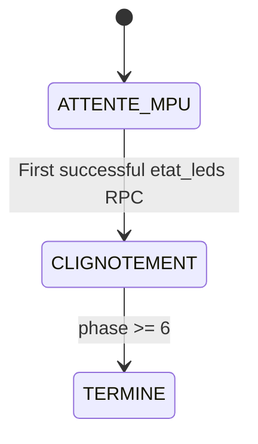

# MCU ↔ MPU Communication: Modulino Buttons and LEDs

This document explains how the UNO Q's **MCU** (Arduino sketch) and **MPU** (`main.py` running on Linux) cooperate to manage the buttons and LEDs of the Modulino Buttons.

---

## 1. Who does what?

| | MCU (STM32, Arduino sketch) | MPU (Linux, `main.py`) |
|---|---|---|
| Role | Physical interface | Application brain |
| Responsibilities | Reads buttons, drives LEDs, signals completion of initialisation, acquires and transmits GPS data | Enforces rules, manages GPS recording and the HTTP server |
| What it knows | The last bitmask received from the MPU (or 0 on failure), the displayed bitmask, the technical initialisation state and local button states | The authoritative application state (**single source of truth**) |
| Application decisions? | No | Yes |

> **Analogy**: the MCU is a **wall-mounted switch with indicator lights**; the MPU is the **electrical control panel**.
> Pressing the switch sends a request to the panel, which decides whether to switch something on and reports what is **actually** on to the indicator lights.
> In this analogy, the switch knows no application rules: it forwards the button press and displays what it is told. It also has a temporary readiness indicator, without making application decisions.

---

## 2. The link between the two: Bridge (RPC)

The **Bridge** allows the MCU to **remotely call a Python function running on the MPU**.
This is a **Remote Procedure Call** (RPC).

**On the MPU side**, functions are **published** (exposed) under a name:

```python
Bridge.provide("bouton", bouton)
Bridge.provide("etat_leds", etat_leds)
```

**On the MCU side**, they are **called** by that name:

```cpp
Bridge.call("bouton", commandes[i])
Bridge.call("etat_leds")
```

Important points:

- The names must be **exactly identical** on both sides.
- In the calls shown here, `result()` waits for the MPU response (or a communication failure) before the MCU continues execution.
- In these exchanges, the MCU initiates the RPC call and the MPU responds.

---

## 3. What is exchanged: a three-bit integer (bitmask)

The MPU does not return three Boolean values, but **a single integer**, in which each of the three least significant bits has a meaning:

| Bit | Value | Meaning (MPU) | LED (MCU) |
|---|---|---|---|
| 0 | 1 | GPS recording active | A |
| 1 | 2 | Recent GPS fix | B |
| 2 | 4 | HTTP server active | C |

Examples:

| Value | Binary | Meaning |
|---|---|---|
| 0 | `000` | None of the three conditions indicated |
| 3 | `011` | Recording + GPS fix |
| 6 | `110` | GPS fix + HTTP active |

- The **MPU constructs** this value using bitwise OR operations `|`.
- The **MCU decodes it** using bitwise AND operations `&`. During initialisation, it also constructs a temporary display bitmask without modifying the stored application bitmask.

---

## 4. The essential principle

> The MCU does not ask **“Did my command succeed?”**
> It asks **“What state is the system in now?”**
>
> During normal operation, the LEDs display **the last state reported by the MPU**, whether the command was accepted or rejected. If communication fails, the stored bitmask becomes 0. During the initialisation blinking sequence, LED C remains temporarily controlled by the MCU; outside that sequence, all three LEDs are switched off on failure.

---

## 5. Path 1: pressing a button

```text
        MCU                                              MPU
 ─────────────────────                     ──────────────────────────────
 lireBoutons()
   detects a press (rising edge)
   Bridge.call("bouton", "START") ───────►  bouton("START")
                                              1. applies application logic
                                                 (executes or rejects)
                                              2. writes a log entry (print)
                                              3. return _etat_leds()
                                                    └─ constructs the bitmask
   .result(etat)  ◄────────────────────────    returned value, e.g. 3
   memoriserEtat(etat)
   then displays according to technical state
```

### In three steps

1. **The MCU sends a command.** It remotely calls `bouton()` with `"START"`, `"STOP"` or `"HTTP"`.
2. **The MPU executes the command if the application logic allows it**, then logs the outcome. It **does not return** whether the command succeeded or failed.
3. **The MPU returns the actual state**, calculated by `_etat_leds()`. The MCU retrieves it into its `etat` variable and passes it to `memoriserEtat(etat)`, which updates the local reference bitmask and, outside the blinking sequence, controls the display.

---

## 6. Path 2: periodic synchronisation (two-second interval)

The state on the MPU side can change **without any button being pressed**:

- a GPS fix can be acquired or lost independently of any button press.

In the architecture chosen for Car_Traces, the MPU does not spontaneously send LED state changes to the MCU: it **responds** to calls.
The MCU therefore **requests** the state regularly (*polling*), once at least two seconds have elapsed since the last synchronisation or the last button-triggered call:

```cpp
void synchroLeds() {
  if (!boutonsOK ||
      millis() - derniereSynchroLeds < 2000UL) return;

  derniereSynchroLeds = millis();
  int etat = 0;

  if (Bridge.call("etat_leds").result(etat)) {
    memoriserEtat(etat);

    if (initialisation == ATTENTE_MPU) {
      initialisation = CLIGNOTEMENT;
      debutClignotement = millis();
      Monitor.println("Car_Traces operationnel");
    }
  } else {
    memoriserEtat(0);
  }
}
```

---

## 7. Understanding the MPU code

### 7.1 `_etat_leds()`: **the only place** where the state bitmask is constructed

```python
def _etat_leds():
    """Calcule le masque des LEDs (bit0=enreg, bit1=fix, bit2=HTTP).
    Interne : l'appelant doit déjà tenir _lock_commandes."""
    with _lock:
        return ((1 if _enreg["actif"] else 0)
                | (2 if fix_recent() else 0)
                | (4 if serveur is not None else 0))
```

- It **reads** the system state and **encodes** it as a bitmask.
- It acquires `_lock`, which protects, among other things, `_enreg` and the data used to determine whether the GPS fix is recent.
- By Python convention, the leading `_` denotes an **internal function**, which is not called directly by the MCU.

### 7.2 `etat_leds()`: **entry point** for synchronisation

```python
def etat_leds():
    """Point d'entrée RPC appelé par le MCU (synchro périodique).
    Prend _lock_commandes puis délègue à _etat_leds()."""
    with _lock_commandes:
        return _etat_leds()
```

- This is the function **published** under the name `"etat_leds"`.
- It acquires `_lock_commandes` so that it **never reads the state in the middle of a command**.
- It then **delegates** the calculation to `_etat_leds()`.

### 7.3 `bouton(commande)`: **application logic** and command entry point

```python
def bouton(commande):
    with _lock_commandes:                      # une seule commande à la fois
        try:
            if commande == "START":
                if serveur is not None:        # règle : pas d'enregistrement si HTTP tourne
                    ok, info = False, "arrêter HTTP avant START"
                else:
                    ok, info = demarrer()
            elif commande == "STOP":
                ok, info = arreter()
            elif commande == "HTTP":           # bascule marche/arrêt
                with _lock:
                    actif = _enreg["actif"]    # lecture protégée, verrou relâché aussitôt
                if actif:                      # règle : pas de HTTP pendant un enregistrement
                    ok, info = False, "enregistrement en cours"
                elif serveur is None:
                    demarrer_serveur()
                    ok, info = True, "HTTP actif"
                else:
                    arreter_serveur()
                    ok, info = True, "HTTP arrêté"
            else:
                ok, info = False, "commande inconnue"
        except OSError as e:                   # erreur système (port occupé, fichier...)
            ok, info = False, str(e)
        print(f"Bouton {commande} : {'OK' if ok else 'refusé'} - {info}", flush=True)
        return _etat_leds()                    # renvoie l'ÉTAT RÉEL au MCU
```

Key points:

- `bouton()` **executes** commands if the application logic allows them.
- `ok` and `info` are used **only for logging** (`print`). They are **never sent to the MCU**.
- `bouton()` **does not construct** the state bitmask: it **forwards** the return value of `_etat_leds()`.

### 7.4 Publishing the functions

```python
Bridge.provide("update_gps", update_gps)
Bridge.provide("bouton", bouton)
Bridge.provide("etat_leds", etat_leds)
App.run()
```

---

## 8. Why two functions, `etat_leds()` and `_etat_leds()`?

Both paths require the same calculation, but under different circumstances:

| Caller | Already holds `_lock_commandes`? | Function used |
|---|---|---|
| MCU, periodic synchronisation | No, it must be acquired | `etat_leds()` |
| End of `bouton()` | **Yes**, already acquired | `_etat_leds()` |

If `bouton()` called `etat_leds()`, it would attempt to **reacquire a lock it already holds**.
With a `threading.Lock`, this causes a **deadlock**: the thread waits indefinitely for itself, and the MCU never receives a response.

Hence the conventional pattern:

- **`etat_leds()`**: public entry point, which acquires the lock;
- **`_etat_leds()`**: internal calculation, which assumes the lock is already held.

Advantage: the state bitmask is calculated in **one place**, so both paths necessarily return the same format.

---

## 9. Understanding the MCU code

### 9.1 Receiving the value: `result(etat)`

```cpp
int etat = 0;
if (Bridge.call("etat_leds").result(etat)) {
  memoriserEtat(etat);
} else {
  memoriserEtat(0);
}
```

Note that there are two distinct things:

- **`etat`** is passed **by reference**: `result()` **writes** the integer value returned by the MPU into it.
- **The return value of `result()`** is a **Boolean**:
  - `true`: the RPC result was retrieved successfully;
  - `false`: the result could not be retrieved (for example, no response). In this case, 0 is stored; outside the blinking sequence, all three LEDs are switched off.

> The MPU knows nothing about the MCU's `etat` variable. It simply returns a **value** between 0 and 7 (bitmasks 5 and 7 are excluded by the application logic during normal operation).
> The MCU stores this value in **its own** local variable `etat`.

> ⚠️ `result()` returns `true` **even if the command was rejected**: it indicates that **the exchange** succeeded, not that the command was accepted.

### 9.2 Decoding: `afficherLeds(etat)`

```cpp
void afficherLeds(int etat) {
  if (!boutonsOK || etat == dernierEtat) return;   // rien à faire si inchangé
  buttons.setLeds((etat & 1) != 0,                  // bit 0 → LED A
                  (etat & 2) != 0,                  // bit 1 → LED B
                  (etat & 4) != 0);                 // bit 2 → LED C
  dernierEtat = etat;
}
```

- Each `etat & n` isolates one bit.
- `dernierEtat` avoids redundant writes to the I2C bus when nothing has changed.

### 9.3 Sending a command: `lireBoutons()`

```cpp
bool appuye = buttons.isPressed(i);
bool front = appuye && !etatPrecedent[i];   // vrai uniquement au moment de l'appui
etatPrecedent[i] = appuye;
if (front) {
  int etat = 0;
  if (Bridge.call("bouton", commandes[i]).result(etat)) memoriserEtat(etat);
  else { memoriserEtat(0); Monitor.println("Pas de réponse de main.py"); }
  derniereSynchroLeds = millis();           // on repousse la prochaine synchronisation
}
```

- **Edge detection** ensures that holding a button down sends **only one** command.

### 9.4 Storing and displaying: two distinct responsibilities

```cpp
int etatMPU = 0;

void memoriserEtat(int etat) {
  etatMPU = etat;
  if (initialisation != CLIGNOTEMENT) {
    afficherLeds(etatMPU);
  }
}
```

| Variable | Role |
|---|---|
| `etat` | Local value received by RPC or temporary bitmask calculated for display, depending on the function |
| `etatMPU` | Last bitmask received from the MPU, or 0 on communication failure |
| `dernierEtat` | Last bitmask sent to the Modulino, initialised to -1 to force the first display update |
| `initialisation` | Technical state of the startup sequence |

During the blinking sequence, new bitmasks continue to be stored. The `signalerInitialisation()` function then uses bits A and B of `etatMPU` and temporarily controls bit C. The MPU remains the single source of truth for application state.

### 9.5 MCU technical state machine

```cpp
enum EtatInitialisation {
  ATTENTE_MPU,
  CLIGNOTEMENT,
  TERMINE
};
EtatInitialisation initialisation = ATTENTE_MPU;
const unsigned long PERIODE_CLIGNOTEMENT = 200UL;
const unsigned int NB_CLIGNOTEMENTS = 3;
unsigned long debutClignotement = 0;
```



- `ATTENTE_MPU`: waits for the first successful synchronisation, regardless of GPS fix availability.
- `CLIGNOTEMENT`: three nominal blinks of LED C.
- `TERMINE`: returns to normal display operation; the sequence does not repeat until the MCU is reset.

The first successful return from `etat_leds()` confirms that communication with `main.py` is working at that moment. It guarantees neither the presence of a GPS fix nor the accessibility of the HTTP server over the network.

This explicit C++ state machine is independent of the MPU's implicit application state machine. It does not modify any START, STOP or HTTP rules.

### 9.6 Timing without `delay()`

```cpp
void signalerInitialisation() {
  if (initialisation != CLIGNOTEMENT) return;

  unsigned long ecoule = millis() - debutClignotement;
  unsigned long phase = ecoule / PERIODE_CLIGNOTEMENT;

  if (phase >= NB_CLIGNOTEMENTS * 2UL) {
    initialisation = TERMINE;
    afficherLeds(etatMPU);
    return;
  }

  int etat = etatMPU & 3;
  if (phase % 2 == 0) {
    etat |= 4;
  }
  afficherLeds(etat);
}
```

`ecoule` is a duration in milliseconds. Integer division by 200 gives a dimensionless phase index. The modulo operation `% 2` distinguishes even phases from odd phases.

| Elapsed time (ms) | Phase | LED C |
|---|---:|---|
| 0 to 199 | 0 | On |
| 200 to 399 | 1 | Off |
| 400 to 599 | 2 | On |
| 600 to 799 | 3 | Off |
| 800 to 999 | 4 | On |
| 1000 to 1199 | 5 | Off |
| From 1200 onwards | 6 or more | Stored application state |

The nominal duration is therefore 3 × 2 × 200 = 1200 ms. Subtracting `unsigned long` values handles `millis()` rollover for this short duration.

The sequence introduces no `delay()`: the loop continues to read the GPS and buttons and synchronise the LEDs. However, synchronous RPC calls may delay an iteration and cause a phase to be skipped; the LED timing is therefore not guaranteed to millisecond precision.

After entering `TERMINE`, the function continues to be called in `loop()`, but returns immediately.

### 9.7 Constructing the temporary bitmask

`etatMPU & 3` preserves bits 0 and 1 (A and B), because 3 is `011` in binary. Bit 2 (C) is cleared.

`etat |= 4` is equivalent to `etat = etat | 4`. Bitwise OR with `100` forces bit 2 to 1 without modifying bits 0 and 1. This is not general addition: a bit that is already 1 remains 1.

| Received bitmask | After `& 3` | Even phase (OR with 4) | Odd phase |
|---|---|---|---|
| `000` (0) | `000` | `100` (4) | `000` (0) |
| `001` (1) | `001` | `101` (5) | `001` (1) |
| `010` (2) | `010` | `110` (6) | `010` (2) |
| `011` (3) | `011` | `111` (7) | `011` (3) |
| `100` (4) | `000` | `100` (4) | `000` (0) |
| `110` (6) | `010` | `110` (6) | `010` (2) |

Bitmasks 5 and 7 are forbidden as application states, but may temporarily appear on the display if recording is active during the blinking sequence. The buttons are not disabled during this sequence. LED C must therefore not be interpreted as an HTTP indicator until the blinking sequence is complete.

The `etatMPU` bitmask is never modified by these operations: only the local variable `etat` is used to construct the temporary bitmask. At the end of the sequence, `afficherLeds(etatMPU)` restores the display corresponding to the last stored bitmask.

The [interactive simulator](https://philippe86220.github.io/Car_Traces/simulateur_bits.html) represents the MPU application bitmasks, not the temporary bitmasks used during the blinking sequence.

---

## 10. The complete journey of the value

```text
MCU  Bridge.call("etat_leds")
        │
        ▼
MPU  etat_leds()          ← acquires _lock_commandes
        │
        ▼
MPU  _etat_leds()         ← acquires _lock, constructs the bitmask
        │  returns application bitmask (0, 1, 2, 3, 4 or 6)
        ▼
     response transmitted through Bridge
        │
        ▼
MCU  result(etat)         ← writes the value into etat, returns true
        │
        ▼
MCU  memoriserEtat(etat)  ← updates etatMPU
        │
        ▼
MCU  afficherLeds(...)    ← application bitmask outside blinking,
                            temporary bitmask via signalerInitialisation() otherwise
```

For a button press, the bitmask follows a similar path: `Bridge.call("bouton", ...)` → `bouton()` → `_etat_leds()` → … the storage and display principles are identical. Only the first successful `etat_leds()` synchronisation triggers the initialisation sequence.

---

## 11. Frequently asked questions

**How does the MCU know that a command was rejected?**
It cannot determine this directly: it receives a bitmask representing the system state, not a command acceptance indicator. The reason for rejection appears in the MPU log (`print`).

**Why does the MCU not make application decisions?**
To maintain **a single source of truth**. All rules (“no START while HTTP is running”, etc.) are located in one place, on the MPU side.

**Why poll the MPU every two seconds?**
Because the state can change without a button press (acquisition or loss of the GPS fix) and, in Car_Traces, the MPU does not spontaneously transmit these changes to the MCU. Synchronisation also restores the display after a communication failure.

**What happens if `main.py` is not running?**
`result()` returns `false` on communication failure and the MCU stores 0. Outside the blinking sequence, it switches off all LEDs; during the sequence, LED C may continue blinking. The message “Pas de réponse de main.py” (no response from main.py) is displayed during a button-triggered call, but not during periodic synchronisation.

**Why does LED C blink even without a GPS fix?**
The first successful RPC synchronisation is sufficient to trigger the indication. The HTTP server can be requested without a GPS fix, provided no recording is active. Starting a recording, however, requires a recent fix.

**Why not modify `etatMPU` directly to blink LED C?**
Because this bitmask must faithfully represent the last application state received (or the fallback bitmask 0). The temporary bitmask is calculated separately, allowing normal display operation to be restored without losing that information.

---

## 12. Glossary

| Term | Meaning here |
|---|---|
| **RPC** (Remote Procedure Call) | The MCU requests execution of a function on the MPU |
| **Publish / expose** | `Bridge.provide` makes a Python function callable by the MCU |
| **Synchronous call** | The MCU waits for a response or communication failure before continuing |
| **Application logic** | The application's operating rules (what is allowed and what is not) |
| **Bitmask** | An integer in which each bit represents a true/false condition |
| **Return value** | The value returned by a function's `return` statement |
| **Pass by reference** | `result(etat)` writes directly into the MCU's `etat` variable |
| **Lock** | Serialises access to data or operations protected by the same lock |
| **Deadlock** | In the case described, a thread waits for a non-reentrant lock it already holds |
| **Rising edge** | The transition from released to pressed, detected once per button press |
| **Polling** | Regularly requesting the current state |
| **Technical state machine** | Local sequence ATTENTE_MPU, CLIGNOTEMENT, TERMINE, independent of application states |
| **Modulo** | Remainder of integer division, used here to determine whether a phase is even or odd |
| **Display bitmask** | Value sent to the Modulino, potentially different from the application bitmask during initialisation |
| **Non-blocking timing** | Time management using `millis()` without deliberate waiting through `delay()` |
