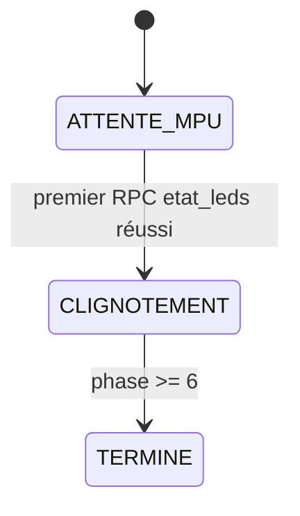

# Liaison MCU ↔ MPU : boutons et LEDs du Modulino

Ce document explique comment le **MCU** (sketch Arduino) et le **MPU** (`main.py` sous Linux) de l'UNO Q coopèrent pour gérer les boutons et les LEDs du Modulino Buttons.

---

## 1. Qui fait quoi ?

| | MCU (STM32, sketch Arduino) | MPU (Linux, `main.py`) |
|---|---|---|
| Rôle | Interface physique | Cerveau de l'application |
| Ce qu'il fait | Lit les boutons, pilote les LEDs, signale la fin de l’initialisation, acquiert et transmet les données GPS | Applique les règles, gère l'enregistrement GPS et le serveur HTTP |
| Ce qu'il sait | Le dernier masque communiqué par le MPU (ou 0 en cas d’échec), le masque affiché, l’état technique d’initialisation et les états locaux des boutons | L’état métier de référence (**seule source de vérité**) |
| Décisions métier ? | Non | Oui |

> **Analogie** : le MCU est un **interrupteur avec voyants** fixé au mur ; le MPU est le **tableau électrique**.
> On appuie sur l'interrupteur, le tableau décide s'il allume ou non, puis renvoie aux voyants ce qui est **réellement** allumé.
> Dans cette analogie, l’interrupteur ne connaît aucune règle métier : il transmet l'appui et affiche ce qu'on lui dit. Il dispose également d’un voyant de mise en service temporaire, sans prendre de décision métier.

---

## 2. Le lien entre les deux : le Bridge (RPC)

Le **Bridge** permet au MCU d'**appeler à distance une fonction Python exécutée sur le MPU**.
C'est un **appel de procédure à distance** (RPC, *Remote Procedure Call*).

**Côté MPU**, on **publie** (on expose) des fonctions sous un nom :

```python
Bridge.provide("bouton", bouton)
Bridge.provide("etat_leds", etat_leds)
```

**Côté MCU**, on les **appelle** par ce nom :

```cpp
Bridge.call("bouton", commandes[i])
Bridge.call("etat_leds")
```

Points importants :

- Les noms doivent être **strictement identiques** des deux côtés.
- Dans les appels présentés ici, `result()` attend la réponse du MPU (ou un échec de communication) avant que le MCU poursuive son exécution.
- Dans ces échanges, c'est le MCU qui initie l'appel RPC et le MPU qui répond.

---

## 3. Ce qui circule : un entier de 3 bits (masque de bits)

Le MPU ne renvoie pas trois booléens mais **un seul entier**, dont chacun des trois bits de poids faible a un sens :

| Bit | Valeur | Signification (MPU) | LED (MCU) |
|---|---|---|---|
| 0 | 1 | Enregistrement GPS en cours | A |
| 1 | 2 | Fix GPS récent | B |
| 2 | 4 | Serveur HTTP actif | C |

Exemples :

| Valeur | Binaire | Signification |
|---|---|---|
| 0 | `000` | Aucun des trois états signalés |
| 3 | `011` | Enregistrement + fix GPS |
| 6 | `110` | Fix GPS + HTTP actif |

- Le **MPU construit** cette valeur avec des OU binaires `|`.
- Le **MCU la décode** avec des ET binaires `&`. Pendant l’initialisation, il construit aussi un masque d’affichage temporaire sans modifier le masque métier mémorisé.

---

## 4. Le principe essentiel

> Le MCU ne demande pas **« ma commande a-t-elle marché ? »**
> Il demande **« dans quel état est le système maintenant ? »**
>
> En fonctionnement normal, les LEDs affichent **le dernier état communiqué par le MPU**, que la commande ait été acceptée ou refusée. En cas d’échec de communication, le masque mémorisé devient 0. Pendant le clignotement d’initialisation, la LED C reste temporairement pilotée par le MCU ; hors de cette séquence, les trois LEDs sont éteintes en cas d’échec.

---

## 5. Chemin n°1 : appui sur un bouton

```
        MCU                                              MPU
 ─────────────────────                     ──────────────────────────────
 lireBoutons()
   détecte un appui (front montant)
   Bridge.call("bouton", "START") ───────►  bouton("START")
                                              1. applique la logique métier
                                                 (exécute ou refuse)
                                              2. écrit une trace (print)
                                              3. return _etat_leds()
                                                    └─ construit le masque
   .result(etat)  ◄────────────────────────    valeur renvoyée, ex. 3
   memoriserEtat(etat)
   puis affichage selon l’état technique
```

### En 3 temps

1. **Le MCU envoie une commande.** Il appelle à distance `bouton()` avec `"START"`, `"STOP"` ou `"HTTP"`.
2. **Le MPU exécute la commande si la logique métier l'autorise**, puis écrit le résultat dans son journal. Il **ne renvoie pas** le succès ou l'échec.
3. **Le MPU renvoie l'état réel**, calculé par `_etat_leds()`. Le MCU le récupère dans sa variable `etat` et le transmet à `memoriserEtat(etat)`, qui actualise le masque de référence local et, hors clignotement, commande l’affichage.

---

## 6. Chemin n°2 : synchronisation périodique (intervalle de 2 secondes)

L'état peut changer côté MPU **sans qu'aucun bouton soit appuyé** :

- le fix GPS peut être acquis ou perdu indépendamment de tout appui sur un bouton.

Dans l’architecture retenue pour Car_Traces, le MPU ne transmet pas spontanément les changements d’état des LEDs au MCU : il **répond** aux appels.
C'est donc le MCU qui **vient demander** l'état régulièrement (*polling*), lorsque 2 secondes au moins se sont écoulées depuis la dernière synchronisation ou le dernier appel déclenché par un bouton :

```cpp
void synchroLeds() {
  if (!boutonsOK ||
      millis() - derniereSynchroLeds < 2000UL) return;

  derniereSynchroLeds = millis();
  int etat = 0;

  if (Bridge.call("etat_leds").result(etat)) {
    memoriserEtat(etat);

    if (initialisation == ATTENTE_MPU) {
      initialisation = CLIGNOTEMENT;
      debutClignotement = millis();
      Monitor.println("Car_Traces operationnel");
    }
  } else {
    memoriserEtat(0);
  }
}
```

---

## 7. Le code MPU expliqué

### 7.1 `_etat_leds()` : **le seul endroit** où l'état est construit

```python
def _etat_leds():
    """Calcule le masque des LEDs (bit0=enreg, bit1=fix, bit2=HTTP).
    Interne : l'appelant doit déjà tenir _lock_commandes."""
    with _lock:
        return ((1 if _enreg["actif"] else 0)
                | (2 if fix_recent() else 0)
                | (4 if serveur is not None else 0))
```

- Elle **lit** l'état du système et le **code** en masque de bits.
- Elle prend `_lock`, qui protège notamment `_enreg` et les données utilisées pour déterminer si le fix GPS est récent.
- Le `_` au début du nom indique, par convention Python, une **fonction interne**, qui n'est pas appelée directement par le MCU.

### 7.2 `etat_leds()` : **point d'entrée** pour la synchronisation

```python
def etat_leds():
    """Point d'entrée RPC appelé par le MCU (synchro périodique).
    Prend _lock_commandes puis délègue à _etat_leds()."""
    with _lock_commandes:
        return _etat_leds()
```

- C'est la fonction **publiée** sous le nom `"etat_leds"`.
- Elle prend `_lock_commandes` pour ne **jamais lire l'état au milieu d'une commande**.
- Elle **délègue** ensuite le calcul à `_etat_leds()`.

### 7.3 `bouton(commande)` : **logique métier** et point d'entrée des commandes

```python
def bouton(commande):
    with _lock_commandes:                      # une seule commande à la fois
        try:
            if commande == "START":
                if serveur is not None:        # règle : pas d'enregistrement si HTTP tourne
                    ok, info = False, "arrêter HTTP avant START"
                else:
                    ok, info = demarrer()
            elif commande == "STOP":
                ok, info = arreter()
            elif commande == "HTTP":           # bascule marche/arrêt
                with _lock:
                    actif = _enreg["actif"]    # lecture protégée, verrou relâché aussitôt
                if actif:                      # règle : pas de HTTP pendant un enregistrement
                    ok, info = False, "enregistrement en cours"
                elif serveur is None:
                    demarrer_serveur()
                    ok, info = True, "HTTP actif"
                else:
                    arreter_serveur()
                    ok, info = True, "HTTP arrêté"
            else:
                ok, info = False, "commande inconnue"
        except OSError as e:                   # erreur système (port occupé, fichier...)
            ok, info = False, str(e)
        print(f"Bouton {commande} : {'OK' if ok else 'refusé'} - {info}", flush=True)
        return _etat_leds()                    # renvoie l'ÉTAT RÉEL au MCU
```

Ce qu'il faut retenir :

- `bouton()` **exécute** les commandes si la logique métier l'autorise.
- `ok` et `info` ne servent **qu'au journal** (`print`). Ils ne sont **jamais envoyés au MCU**.
- `bouton()` **ne construit pas** l'état : elle **relaie** la valeur de retour de `_etat_leds()`.

### 7.4 Publication des fonctions

```python
Bridge.provide("update_gps", update_gps)
Bridge.provide("bouton", bouton)
Bridge.provide("etat_leds", etat_leds)
App.run()
```

---

## 8. Pourquoi deux fonctions, `etat_leds()` et `_etat_leds()` ?

Les deux chemins ont besoin du même calcul, mais dans des situations différentes :

| Appelant | Tient déjà `_lock_commandes` ? | Fonction utilisée |
|---|---|---|
| MCU, synchronisation périodique | Non, il faut le prendre | `etat_leds()` |
| Fin de `bouton()` | **Oui**, déjà pris | `_etat_leds()` |

Si `bouton()` appelait `etat_leds()`, elle essaierait de **reprendre un verrou qu'elle tient déjà**.
Avec un `threading.Lock`, cela provoque un **interblocage (deadlock)** : le thread s'attend lui-même indéfiniment, et le MCU ne reçoit jamais de réponse.

D'où le schéma classique :

- **`etat_leds()`** : point d'entrée public, qui prend le verrou ;
- **`_etat_leds()`** : calcul interne, qui suppose le verrou déjà pris.

Avantage : l'état est calculé à **un seul endroit**, donc les deux chemins renvoient forcément le même format.

---

## 9. Le code MCU expliqué

### 9.1 Réception de la valeur : `result(etat)`

```cpp
int etat = 0;
if (Bridge.call("etat_leds").result(etat)) {
  memoriserEtat(etat);
} else {
  memoriserEtat(0);
}
```

Attention, deux choses distinctes :

- **`etat`** est passé **par référence** : `result()` y **écrit** la valeur entière renvoyée par le MPU.
- **La valeur renvoyée par `result()`** est un **booléen** :
  - `true` : le résultat de l’appel RPC a été récupéré avec succès ;
  - `false` : échec de récupération du résultat (par exemple, absence de réponse). Dans ce cas, on mémorise 0 ; hors clignotement, les trois LEDs sont éteintes.

> Le MPU ne connaît pas la variable `etat` du MCU. Il renvoie simplement une **valeur** comprise entre 0 et 7 (les masques 5 et 7 sont exclus par la logique métier en fonctionnement normal).
> C'est le MCU qui range cette valeur dans **sa** variable locale `etat`.

> ⚠️ `result()` renvoie `true` **même si la commande a été refusée** : il indique que **l'échange** a réussi, pas que la commande a été acceptée.

### 9.2 Décodage : `afficherLeds(etat)`

```cpp
void afficherLeds(int etat) {
  if (!boutonsOK || etat == dernierEtat) return;   // rien à faire si inchangé
  buttons.setLeds((etat & 1) != 0,                  // bit 0 → LED A
                  (etat & 2) != 0,                  // bit 1 → LED B
                  (etat & 4) != 0);                 // bit 2 → LED C
  dernierEtat = etat;
}
```

- Chaque `etat & n` isole un bit.
- `dernierEtat` évite de réécrire sur le bus I2C quand rien n'a changé.

### 9.3 Envoi d'une commande : `lireBoutons()`

```cpp
bool appuye = buttons.isPressed(i);
bool front = appuye && !etatPrecedent[i];   // vrai uniquement au moment de l'appui
etatPrecedent[i] = appuye;
if (front) {
  int etat = 0;
  if (Bridge.call("bouton", commandes[i]).result(etat)) memoriserEtat(etat);
  else { memoriserEtat(0); Monitor.println("Pas de réponse de main.py"); }
  derniereSynchroLeds = millis();           // on repousse la prochaine synchronisation
}
```

- La **détection de front** garantit qu'un appui maintenu n'envoie **qu'une seule** commande.

### 9.4 Mémorisation et affichage : deux responsabilités distinctes

```cpp
int etatMPU = 0;

void memoriserEtat(int etat) {
  etatMPU = etat;
  if (initialisation != CLIGNOTEMENT) {
    afficherLeds(etatMPU);
  }
}
```

| Variable | Rôle |
|---|---|
| `etat` | Valeur locale reçue par RPC ou masque temporaire calculé pour l’affichage, selon la fonction |
| `etatMPU` | Dernier masque reçu du MPU, ou 0 en cas d’échec de communication |
| `dernierEtat` | Dernier masque envoyé au Modulino, initialisé à -1 pour forcer le premier affichage |
| `initialisation` | État technique de la séquence de démarrage |

Pendant le clignotement, les nouveaux masques continuent à être mémorisés. La fonction `signalerInitialisation()` utilise alors les bits A et B de `etatMPU` et pilote temporairement le bit C. Le MPU reste la seule source de vérité métier.

### 9.5 Machine à états technique du MCU

```cpp
enum EtatInitialisation {
  ATTENTE_MPU,
  CLIGNOTEMENT,
  TERMINE
};
EtatInitialisation initialisation = ATTENTE_MPU;
const unsigned long PERIODE_CLIGNOTEMENT = 200UL;
const unsigned int NB_CLIGNOTEMENTS = 3;
unsigned long debutClignotement = 0;
```



- `ATTENTE_MPU` : attente de la première synchronisation réussie, indépendamment du fix GPS.
- `CLIGNOTEMENT` : trois clignotements nominaux de la LED C.
- `TERMINE` : retour à l’affichage normal ; la séquence ne se répète pas avant une réinitialisation du MCU.

Le premier retour réussi de `etat_leds()` confirme que la communication avec `main.py` fonctionne à cet instant. Il ne garantit ni la présence d’un fix GPS ni l’accessibilité du serveur HTTP sur le réseau.

Cette machine à états explicite en C++ est indépendante de la machine à états métier implicite du MPU. Elle ne modifie aucune règle START, STOP ou HTTP.

### 9.6 Temporisation sans `delay()`

```cpp
void signalerInitialisation() {
  if (initialisation != CLIGNOTEMENT) return;

  unsigned long ecoule = millis() - debutClignotement;
  unsigned long phase = ecoule / PERIODE_CLIGNOTEMENT;

  if (phase >= NB_CLIGNOTEMENTS * 2UL) {
    initialisation = TERMINE;
    afficherLeds(etatMPU);
    return;
  }

  int etat = etatMPU & 3;
  if (phase % 2 == 0) {
    etat |= 4;
  }
  afficherLeds(etat);
}
```

`ecoule` est une durée en millisecondes. La division entière par 200 donne un numéro de phase, sans unité. Le modulo `% 2` permet de distinguer les phases paires des phases impaires.

| Temps écoulé (ms) | Phase | LED C |
|---|---:|---|
| 0 à 199 | 0 | Allumée |
| 200 à 399 | 1 | Éteinte |
| 400 à 599 | 2 | Allumée |
| 600 à 799 | 3 | Éteinte |
| 800 à 999 | 4 | Allumée |
| 1000 à 1199 | 5 | Éteinte |
| À partir de 1200 | 6 ou plus | État métier mémorisé |

La durée nominale est donc de 3 × 2 × 200 = 1200 ms. La soustraction de valeurs `unsigned long` permet de gérer le débordement de `millis()` pour cette courte durée.

La séquence n’introduit aucun `delay()` : la boucle continue à lire le GPS, les boutons et à synchroniser les LEDs. Toutefois, les appels RPC synchrones peuvent retarder une itération et conduire à sauter une phase ; les durées lumineuses ne sont donc pas garanties à la milliseconde près.

Après le passage à `TERMINE`, la fonction reste appelée dans `loop()`, mais retourne immédiatement.

### 9.7 Construction du masque temporaire

`etatMPU & 3` conserve les bits 0 et 1 (A et B), car 3 vaut `011` en binaire. Le bit 2 (C) est effacé.

`etat |= 4` équivaut à `etat = etat | 4`. Le OU binaire avec `100` force le bit 2 à 1 sans modifier les bits 0 et 1. Il ne s’agit pas d’une addition générale : un bit déjà à 1 reste à 1.

| Masque reçu | Après `& 3` | Phase paire (OU avec 4) | Phase impaire |
|---|---|---|---|
| `000` (0) | `000` | `100` (4) | `000` (0) |
| `001` (1) | `001` | `101` (5) | `001` (1) |
| `010` (2) | `010` | `110` (6) | `010` (2) |
| `011` (3) | `011` | `111` (7) | `011` (3) |
| `100` (4) | `000` | `100` (4) | `000` (0) |
| `110` (6) | `010` | `110` (6) | `010` (2) |

Les masques 5 et 7 sont interdits comme états métier, mais peuvent apparaître temporairement à l’affichage si un enregistrement est actif pendant le clignotement. Les boutons ne sont pas désactivés pendant cette séquence. La LED C ne doit donc pas être interprétée comme un indicateur HTTP avant la fin du clignotement.

Le masque `etatMPU` n’est jamais modifié par ces opérations : seule la variable locale `etat` est utilisée pour construire le masque temporaire. À la fin de la séquence, `afficherLeds(etatMPU)` rétablit l’affichage correspondant au dernier masque mémorisé.

Le [simulateur interactif](https://philippe86220.github.io/Car_Traces/simulateur_bits.html) représente les masques métier du MPU, et non les masques temporaires de la séquence lumineuse.

---

## 10. Le trajet complet de la valeur

```
MCU  Bridge.call("etat_leds")
        │
        ▼
MPU  etat_leds()          ← prend _lock_commandes
        │
        ▼
MPU  _etat_leds()         ← prend _lock, construit le masque
        │  return masque métier (0, 1, 2, 3, 4 ou 6)
        ▼
     réponse transmise par le Bridge
        │
        ▼
MCU  result(etat)         ← écrit la valeur dans etat, renvoie true
        │
        ▼
MCU  memoriserEtat(etat)  ← actualise etatMPU
        │
        ▼
MCU  afficherLeds(...)    ← masque métier hors clignotement,
                            masque temporaire via signalerInitialisation() sinon
```

Pour un appui sur un bouton, le chemin de transmission du masque est analogue : `Bridge.call("bouton", ...)` → `bouton()` → `_etat_leds()` → … la mémorisation et le principe d’affichage sont identiques. Seule la première synchronisation `etat_leds()` réussie déclenche la séquence d’initialisation.

---

## 11. Questions fréquentes

**Comment le MCU sait-il qu'une commande a été refusée ?**
Il ne peut pas le déterminer directement : il reçoit un masque représentant l’état du système, et non un indicateur d’acceptation de la commande. Le motif du refus figure dans le journal du MPU (`print`).

**Pourquoi le MCU ne prend-il pas les décisions métier ?**
Pour avoir **une seule source de vérité**. Toutes les règles (« pas de START si HTTP tourne », etc.) sont au même endroit, côté MPU.

**Pourquoi interroger le MPU toutes les 2 s ?**
Parce que l’état peut changer sans appui (acquisition ou perte du fix GPS) et que, dans Car_Traces, le MPU ne transmet pas spontanément ces changements au MCU. La synchronisation permet aussi de rétablir l’affichage après un échec de communication.

**Que se passe-t-il si `main.py` ne tourne pas ?**
`result()` renvoie `false` en cas d’échec de communication et le MCU mémorise 0. Hors clignotement, il éteint toutes les LEDs ; pendant la séquence, la LED C peut encore clignoter. Le message « Pas de réponse de main.py » est affiché lors d’un appel déclenché par un bouton, mais pas lors de la synchronisation périodique.

**Pourquoi la LED C clignote-t-elle même sans fix GPS ?**
La première synchronisation RPC réussie suffit à déclencher la signalisation. Le serveur HTTP peut être demandé sans fix GPS, à condition qu’aucun enregistrement ne soit actif. Pour démarrer un enregistrement, il faut en revanche un fix récent.

**Pourquoi ne pas modifier directement `etatMPU` pour faire clignoter C ?**
Parce que ce masque doit rester fidèle à la dernière information métier reçue (ou au masque de repli 0). Le masque temporaire est calculé séparément, ce qui permet de restaurer l’affichage normal sans perdre cette information.

---

## 12. Vocabulaire

| Terme | Signification ici |
|---|---|
| **RPC** (appel de procédure à distance) | Le MCU demande l’exécution d’une fonction sur le MPU |
| **Publier / exposer** | `Bridge.provide` rend une fonction Python appelable par le MCU |
| **Appel synchrone** | Le MCU attend la réponse ou un échec de communication avant de continuer |
| **Logique métier** | Les règles de fonctionnement de l'application (ce qui est autorisé ou non) |
| **Masque de bits** | Un entier où chaque bit représente une information vrai/faux |
| **Valeur de retour** | Ce que renvoie le `return` d'une fonction |
| **Passage par référence** | `result(etat)` écrit directement dans la variable `etat` du MCU |
| **Verrou (lock)** | Sérialise les accès aux données ou opérations protégées par le même verrou |
| **Interblocage (deadlock)** | Dans le cas présenté, un thread attend un verrou non réentrant qu’il détient déjà |
| **Front montant** | Le passage de « relâché » à « appuyé », détecté une seule fois par appui |
| **Polling** | Interroger régulièrement pour connaître un état |
| **Machine à états technique** | Séquence locale ATTENTE_MPU, CLIGNOTEMENT, TERMINE, indépendante des états métier |
| **Modulo** | Reste de la division entière, utilisé ici pour déterminer la parité d’une phase |
| **Masque d’affichage** | Valeur envoyée au Modulino, éventuellement différente du masque métier pendant l’initialisation |
| **Temporisation non bloquante** | Gestion du temps par `millis()` sans attente volontaire par `delay()` |
